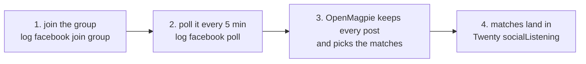

# Listening to local Facebook groups

The same accounts can join the local groups in their town and hear when someone asks for what the business sells ("anyone know someone who can take away an old sofa?"). This page shows the parts.

## How it runs

An account asks to join a neighbourhood group in its town. Once in, each read brings back the group's newest posts with their comments. Where the account has a saved session, the direct-API engine (fbk) reads the feed without opening a browser at all; otherwise the read is a tab in the account's open browser.

## The commands

| Step | Command | MCP tool | What decides it |
| --- | --- | --- | --- |
| Join | `log facebook join group --account <a> --group <url or id> [--live]` | `join`, `joinLive` | the group's own join state |
| Read | `log facebook read group --account <a> --group <id>` | `readGroup` | the feed's answer; the direct API first, the browser behind it |
| Poll | `log facebook poll <group> <account> <how long>` | `poll` | each read's answer; OpenMagpie's watch picks the matches |
| Members | `log facebook read members --account <a> --group <g> --count 40 --owners` | `readMembers` | the members list's answers, about 10 more per scroll |

`read members --owners` keeps people whose bio says owner, founder, CEO or self-employed, or who run a page, saved under `~/.logCli/members/`.

## Not built yet

Acting on a match (a comment or a message from the same account).

Sources: `docs/groupListening.md`, `docs/groupMembers.md`, `docs/commandNaming.md`.
