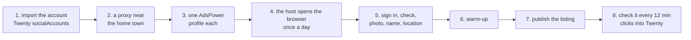
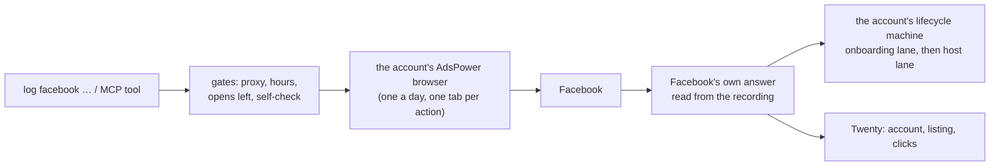

# From accounts to live Marketplace listings

How a local service business gets listings in front of people in every town it serves: take aged Facebook accounts, turn each one into a believable local profile, and post a listing from each one. This page walks one account all the way through, shows which part of log-cli does each step, and what decides that the step worked.

## The idea in one line

One account per town. Each one gets a proxy in that town, its own browser profile, a photo, a cover, a name and a location, a day of normal browsing, and then one listing, all checked against Facebook's own answers.

## One account, end to end

- **Imported** into Twenty with its home town, cookies and two-step secret.
- **Proxy:** a residential proxy near the home town, checked for country and distance before it's saved.
- **Location:** typing "City, ST" can be offered as a different place entirely (a town of the same name abroad), and a bare zip can be offered as another country first. So locations are always typed with the state written out, "City, State" (rules 68 and 72).
- **Listing:** the service, a price and photos. Facebook's create answer returns the listing id, under review at first, and Twenty marks it UNDER_REVIEW, then live.
- **Taken down** when needed: the delete answer names the listing id, and the row becomes REMOVED (rows are never deleted, rule 13).

Count the cost per account (the account, its proxy traffic, the browser profile) against what one lead is worth before scaling to many towns.

## The steps and the commands

Every Facebook command starts with the platform (`log facebook …`), and each has an MCP tool. Anything that changes something on Facebook is its own `…Live` tool and needs `confirmLive` (rule 8).

| Step | Command | MCP tool | What decides it worked |
| --- | --- | --- | --- |
| Import | `scripts/twenty/importVendorAccounts.mjs` | – | the row in Twenty `socialAccounts` |
| Proxy | `log proxy assign --account <a> --vendor <vendor>`, `log proxy check` | `proxy` | the exit IP is in the home country and within 100 km of the home town |
| Browser profile | `log adsPower sync --apply` | `adsPower` | one AdsPower profile per account, linked in `adsPowerProfileId` |
| Ready? | `log facebook preflight` | `preflight` | hours, proxy, kernel, opens left, photo on disk, before anything opens |
| Open the day | `log facebook host start --account <a> --live` | `hostStartLive` | the browser's own timezone, language and exit IP match the account |
| Sign in | `log facebook connect --account <a>` (the host does it) | `connect` | Facebook's `c_user` and `xs` cookies |
| Account check | `log facebook check --account <a>` | `check` | `/marketplace/status` says selling is open |
| Photo, cover, name | `log facebook profile setup --account <a> --live` | `profileLive` | the photo and name saves answer without an error |
| Location | `log inspect do setLocation "<City>, <State>" --live` (the host does it) | `inspectDoLive` | the location save's answer names the town |
| Warm-up | `log facebook warmup stages run`, `log facebook warmup reel` | `warmup`, `warmupLive` | the five browsing activities each see their own answer; then 24 h before it's ready |
| Copy | `log facebook listing create`, `listing lint` | `listingCreate`, `listingLint` | at least 3 versions per ad, each title at least half different |
| Publish | `log flow run marketplaceListingPublish --account <a> --live` | `flowMarketplaceListingPublishLive` | the create answer returns the listing id |
| Many towns | `log facebook campaign fill`, `run`, `heal` | `campaign`, `campaignLive` | one copy per account, a lost account's copy handed to another in the same area |
| Watch | the host, every 12 minutes, or `log facebook check` | `check` | each listing's state and clicks from the Selling page, into `agencyListings` |
| Take down | `log facebook listing remove <id> --live` | `listingRemoveLive` | the delete answer names the listing |

## What keeps an account safe

- **One browser a day.** The host opens each account's browser once per local day and keeps it open; every action is a tab in it (rule 35). On top of that, an account's browser opens at most 8 times a day, 10 minutes apart (rule 24).
- **The proxy first.** No browser opens without a proxy in the account's home country (rule 12).
- **Local hours.** Nothing runs outside 08:00–22:00 in the account's home town unless the owner asks (rules 18 and 20).
- **The same device every time.** Each account keeps one fingerprint (rule 15).
- **Recorded.** Every step is recorded, and Facebook's own answers decide what happened, never the screen (rule 73).

## What log-cli does underneath

- Each account runs one lifecycle machine (`src/marketplace/lifecycle`): proxying, opening, signingIn, checkingAccount, settingProfile, settingName, settingLocation, warming, attached, then watching and checking.
- Flows are recorded once with `log inspect` and then replayed on any account (`src/browser/flow/definitions/*.json`, docs in `docs/platforms/facebook/flows/`).
- When a step lands somewhere new, its internal API calls are read, SubQ is asked what they mean, and the new state gets a name (rule one at the top of `AGENTS.md`).

## When accounts are lost

Not every account makes it. Some are lost before or after their first listing: a video selfie, a wrong password, or an identity check on a live listing. Their listings go to ACCOUNT_LOST, and a campaign hands each lost copy to another account in the same area (`log facebook listing sweep`). A checkpointed account is deactivated and gives its browser profile back (rules 78 and 82).

## Not built yet

- Reading buyers' messages into Twenty and replying to them (`log facebook conversations` keeps what's recorded, but the host doesn't act yet).
- Publishing as a tab of the host's browser for every path (the recorded flow does; the older `log facebook publish` still opens its own browser).

## Ways to reuse it

The pipeline doesn't care what the listing sells. Anything that wants a local profile in many towns uses the same parts: the proxy per town, the profile, the warm-up, the recorded publish flow, and the 12-minute check. A new kind of listing is a new copy set and photos (`skills/listingCopy`, `skills/listingCreative`), not new code.

Sources here: `docs/lifecycle.md`, `docs/accountsAndListings.md`, `docs/proxies.md`, `docs/adsPower.md`, `skills/host/SKILL.md`.
