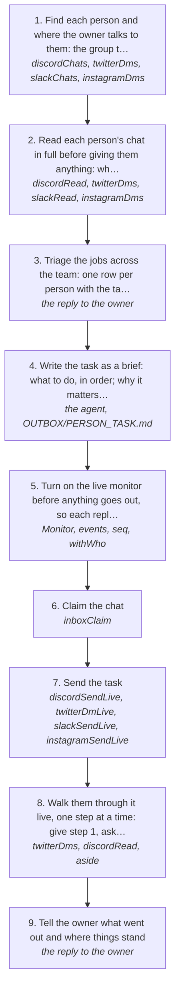

# Bossmaxxing: giving out tasks to the team

Give out tasks to the people the owner works with, wherever they are (a Discord group, an X DM, Slack, Instagram), and keep track of every job across the team: who has what, what they owe, what's blocked. Each task goes out as a brief that says what to do, why, what done looks like and by when. A live monitor stays on, so every reply is answered as it lands, and someone being set up is walked through one step at a time until it works.

How the owner asks for it: "bossmaxxing", "give out the tasks", "send <person> the task in <group> and tag them", "tell <person> about everything I researched and give them an outline", "triage the jobs across the team", "walk <person> through setting up <tool>", "help <person> get set up like we did with <other person>"

## Run it from a fresh context

Say: **"go on docs/useCases/inbox/bossMaxxing.md for <people or group>"**. The agent reads this page and runs the steps.

## The steps

<!-- stepsDiagram: written by `bun run docs:build` from the steps table below, not edited by hand -->

<!-- /stepsDiagram -->

| # | Step | Tool | Done when |
| --- | --- | --- | --- |
| 1 | Find each person and where the owner talks to them: the group they're in, or their DM, on whichever platform he named | `discordChats`, `twitterDms` { account, limit }, `slackChats`, `instagramDms` | every person has one chat, named as the owner says it ("the aeo group", "@someone on X"), never an id (rule 155) |
| 2 | Read each person's chat in full before giving them anything: what they were last told, what they owe, what they said back, and what they sent (files and sheets open through the read) | `discordRead` { channel, limit: "120" }, `twitterDms` { with }, `slackRead` { chat }, `instagramDms` { with } | for each person: the last task, its status and the time of their last message |
| 3 | Triage the jobs across the team: one row per person with the task, its status (done, waiting on them, waiting on the owner, blocked), the last update with its time, and the next move | the reply to the owner | the owner can see who has what in one table |
| 4 | Write the task as a brief: what to do, in order; why it matters; what done looks like and by when; what to do if they're stuck. When it carries research or a long outline, put it in a file in `OUTBOX/` (plain words, no frontmatter) and keep the message short | the agent, `OUTBOX/<PERSON>_<TASK>.md` | the brief answers clear, why, done when, kind and how to ask (rule 162) |
| 5 | Turn on the live monitor before anything goes out, so each reply wakes the agent the moment it lands | `Monitor` { timeout_ms: 1800000 } on a small `bun:sqlite` poll of `~/.logCli/log.db`: every 3 s, print each new `events` row past the last `seq` whose type is message, mention or reply, with its platform, `withWho`, text and conversation; re-armed on expiry (rules 130, 134) | the monitor prints a test line from a message that just landed |
| 6 | Claim the chat | `inboxClaim` { platform, account, chat, event } | this session holds the chat (rule 133) |
| 7 | Send the task. In a group, tag the person (`<@their id>` on Discord) and send it as a brief with the file attached. In a DM, send it one message per line. Bossmaxxing always goes over the voice gate: the owner said so, so don't rewrite a draft to pass it | `discordSendLive` { channel, text, brief: true, file, approvedBy: "matt", confirmLive: true, overGate: true }, `twitterDmLive` { userId, text, overGate: true }, `slackSendLive`, `instagramSendLive` (rule 152) | the platform answers `sent` |
| 8 | Walk them through it live, one step at a time: give step 1, ask them to say done, read what they send back, then give step 2. Ask for the one thing a setup needs from them (their email, a login). Do the owner's side yourself through the tool that holds it, such as an invite in a web dashboard through the Aside REPL | the monitor, `twitterDms` { with } or `discordRead` before each reply, `aside repl` for a dashboard | each step is confirmed by what they sent back, not assumed |
| 9 | Tell the owner what went out and where things stand | the reply to the owner | who got what, what they said, what is still pending, and anything only the owner can do |

## What the runs taught

- **The monitor reads `log.db`, never `pending.jsonl`.** Since rule 134 every pushed message lands in the `events` table, and `pending.jsonl` is no longer written. A monitor tailing it stays silent while the person writes, and that's how a teammate got left waiting. A message X Chat couldn't open on the push lands as a `message` with no text beside an `unopened` row: read the chat with `twitterDms` { with, full: true } and it opens.
- **A task is a brief, not a chat message.** `brief: true` on `discordSendLive` gates it on clear, why, done when, kind and how to ask (rule 162). A brief with no "done when" or no deadline comes back as "what do you want me to do".
- **Give the same access the others have.** Before inviting someone to a shared tool, look at who is already in it and with which role (a dashboard's members or pending invitations), and give the new person the same role.
- **Ask for one thing at a time.** "What email do you want the invite on" got an answer in a minute. A long setup message with the question at the end didn't.
- **They write while it's going out.** A send that is one message per line stops when they reply partway through (`>>> INTERRUPTED`, rule 130). Read what they said, answer it, then send the held lines if they still fit.
- **A burst of empty X Chat events right after you message is read receipts, not messages.** Read the person fresh with `twitterDms` { with, full: true } before saying they wrote anything.
- **X DMs are checked against house style.** A domain or an email address counts as a full stop. Write "your gmail" or the domain without its ending, or keep the address for the dashboard.
- **The work runs in a harness, never in a browser by hand.** When someone does research or lead work, they run it from a coding agent (T3 Code, Claude Code, Codex), and web pages are read through the Aside REPL. Lists come back as a `.tsv` (one row per line, tab between columns), never a pasted table.
- **Report money as it's spent.** When a step costs something (a lookup, an email check), say what it cost next to what it found, and stop to ask the owner before anything he didn't ask to pay for (rule 41).
- **The live chat starts where the owner says.** If the person is on two platforms and the owner names one, answer there and point the other chat to it.
- **A play must be loaded before sending as the owner.** A send with no play loaded is refused `playMissing` (rule 157). This page is that play.
- **A booked call, a sale or a request for access waits for the owner.** On 2026-11-08 a teammate reported a client call booked for 1 pm, said he'd upsell the CRM, then asked for access to the dialer, which email it's on, and shared a Twenty invite link. Each of those is a meeting, money or access to the owner's tools, so nothing went out: tell the owner what was said and in which group, and leave the answer to him (rule 108). "The sales guy" a teammate brings in is introduced the same way. Say who he is and leave the welcome to the owner.
- **Once the owner says help them with it, help them.** The same day the owner said to help that teammate with the dialer: get him to explain what's happening first ("is it not letting you in or what"), then fix it. A password to the owner's own accounts (a Google admin sign-in, say) is still the owner's to give, never the agent's.
- **The boss fixes it himself.** The owner's words, 2026-11-08: "the point of being a boss is that you are the one who is asked a question to solve something and you be a boss and do it yourself". Teammates often say things with no context and expect them to work. Don't hand them a list of steps to do. Find the cause through the tools and keys you hold (the repo, its `.env.local`, the servers over Tailscale, Vercel), fix it, check it works, then tell them it's done and what to do next. Tell them to leave it alone while you work on it.
- **Over the gate, every time.** The owner's words, 2026-11-08: "go over the gate when your boss maxxing". Two plain questions to a teammate scored 0.60 and 0.75 on the gate and held him up. Every bossmaxxing send goes with `overGate: true`. The AI artifact check still runs.
- **Everything runs on node02 and listeningkit.com.** ListeningKit's Twenty is `twenty.listeningkit.com` on node02, and the tools sit on `*.listeningkit.com` subdomains, mostly behind Cloudflare. The dialer is `dialer.listeningkit.com` and signs in with a `twenty.listeningkit.com` account; it has no login of its own. inferencesaver and node01 are the old setup: never point anyone at them, and never send anyone to `cold-dialer.listeningkit.railcode.app`, whose trial has ended. The dialer's code and keys are in `REPOS/dialer` (`.env.local`). Before changing it, check its branch and uncommitted work, since a move may already be half done there.
- **Say who broke it.** On 2026-11-08 the dialer let nobody in. A teammate had moved it over, stopped node01's Twenty (`twenty-server` stopped on 1 Nov), and never pointed the rest at node02. Tell them plainly that it's on them, then help them fix it.
