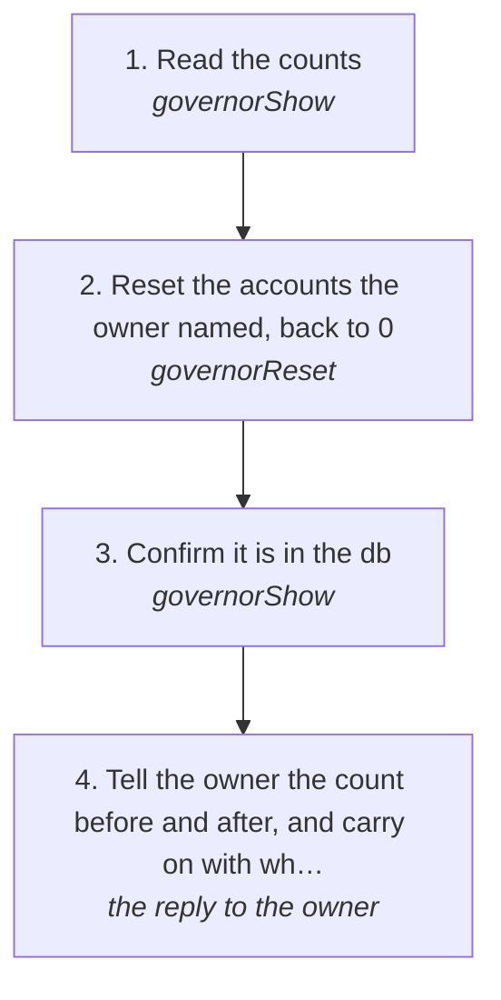

# Resetting an account's governor count

Every platform account's governor counts what it sent today and refuses once the count is spent ("daily cap reached (500/day)"). When the owner says to, the count goes back to 0 so the work can carry on, on X, Discord, Slack, Instagram, Reddit, LinkedIn or Facebook alike. The reset is checked and kept in log.db, so it is never a hand edit nobody can see (rule 168).

How the owner asks for it: "reset the governor on X back to 0", "confirm it's in the db", "reset X to 0", "reset the limit back to 0 from 500", "reset the platforms count to 0"

## Run it from a fresh context

Say: **"go on docs/useCases/inbox/governorReset.md for <platform> <account or all>"**. The agent reads this page and runs the steps.

## The steps

<!-- stepsDiagram: written by `bun run docs:build` from the steps table below, not edited by hand -->

<!-- /stepsDiagram -->

| # | Step | Tool | Done when |
| --- | --- | --- | --- |
| 1 | Read the counts | `governorShow` { platform } | each account's requests, writes, this hour and any cooldown |
| 2 | Reset the accounts the owner named, back to 0 | `governorReset` { platform, account, by: "matt", reason: "<what the owner said>" } | each account reads 0 and names its log.db ledger row |
| 3 | Confirm it is in the db | `governorShow` { platform } | each account shows 0 requests and its last reset as a ledger row |
| 4 | Tell the owner the count before and after, and carry on with what was blocked | the reply to the owner | the owner knows each account is back to 0 |

`account: "all"` resets every account on that platform. A cooldown after a block is kept: a blocked account resumes only when the owner says so (rule 94), and the platform's own answer still decides (rule 73).
