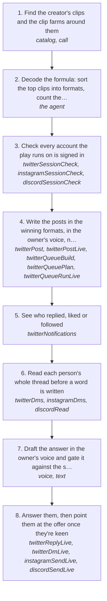

# /rea-looksmaxxing: moneymaxx like a creator

Reverse engineer how a creator gets paid, then run the same play on your own accounts. treg reads the social data (the creator's most viral clips, the clip farms reposting them, views and comments), the formula is decoded from what won, and log posts it through your accounts and funnels everyone who replies or DMs into your offer, every message checked against how you write. Clavicular is the worked example: 40 of his clips pulled, the top one at 8.44M views, a looksmaxxing program as the offer. The video and the page (`log.listeningkit.com/rea-looksmaxxing`) tell the same play.

How the owner asks for it: "/rea-looksmaxxing how clavicular gets paid", "moneymaxx like <creator>", "how does <creator> get paid"

## Run it from a fresh context

Say: **"go on docs/useCases/inbox/reaLooksmaxxing.md for <creator> and <offer>"**. The agent reads this page and treg's `web-access` skill, loads `getGuide({ topic: "xSending" })` before anything on X, and runs the steps. Outside this repo the same play is the `rea-looksmaxxing` skill: `curl -fsSL https://log.listeningkit.com/install.sh | sh -s -- --skills rea-looksmaxxing --skillsOnly` installs it with treg's `treg` and `web-access` skills beside it (on Windows, set `LOG_SKILLS=rea-looksmaxxing` and `LOG_SKILLS_ONLY=1` before `irm https://log.listeningkit.com/install.ps1 | iex`), and `npx skills add log.listeningkit.com` finds it too.

## The steps

<!-- stepsDiagram: written by `bun run docs:build` from the steps table below, not edited by hand -->

<!-- /stepsDiagram -->

| # | Step | Tool | Done when |
| --- | --- | --- | --- |
| 1 | Find the creator's clips and the clip farms around them. Search treg's catalog by the job ("tiktok search videos", "tiktok user posts", "instagram user reels", "x user tweets"), never a remembered id. Say the price before the batch and cap it with `X-Treg-Route-Max-Cost` | treg `catalog search`, `catalog get`, `call` | every clip with its account, caption, views, likes, date and URL |
| 2 | Decode the formula: sort the top clips into formats, count the views per format, and note the hook, the tension and the payoff of the best one in each. Find how the creator sells (a program, a Discord, merch, a link in bio) | the agent | the 3 formats with the most views, each with its proof clip, and the funnel |
| 3 | Check every account the play runs on is signed in | `twitterSessionCheck`, `instagramSessionCheck`, `discordSessionCheck` | the platform says loggedIn |
| 4 | Write the posts in the winning formats, in the owner's voice, never copied. One goes out with `twitterPostLive`; several through the account's one queue at random times | `twitterPost`, `twitterPostLive`, or `twitterQueueBuild`, `twitterQueuePlan`, `twitterQueueRunLive` | X answers `sent` |
| 5 | See who replied, liked or followed | `twitterNotifications` | a list of real people and what they did |
| 6 | Read each person's whole thread before a word is written | `twitterDms` { with }, `instagramDms`, `discordRead` | what they asked and where the talk stands |
| 7 | Draft the answer in the owner's voice and gate it against the same person | `voice` { to, with, context }, then `voice` with `text` | the gate passes |
| 8 | Answer them, then point them at the offer once they're keen. The first message is about them, never the pitch | `twitterReplyLive`, `twitterDmLive`, `instagramSendLive`, `discordSendLive` | the platform answers `sent`, and they're in the Discord or on the offer |

## What to know

- **Social data costs money.** Search and page reads through treg are free with TinyFish, but platform data (TikTok, Instagram, X posts and comments) costs cents a call. Say the price first and cap every batch (rule 41).
- **The numbers are real, the scores are not.** Every view count keeps its source URL. A format score is the agent's reading of the views, not a fact.
- **Sends follow the account's rules.** Reads first, every `…Live` tool needs `confirmLive: true`, one session per account, never in quick succession, and a 429 or any refusal stops the run (rules 8, 94, 105).
- **Sell the outcome.** Step 7 of the video says to build the offer on people's insecurities and adds "we don't recommend it". The play doesn't either.
- The video's beats, copy rules and render steps are in the `reaLooksmaxxing` skill (`skills/reaLooksmaxxing/SKILL.md`); the play everyone can install is `skills/published/reaLooksmaxxing/SKILL.md`.
