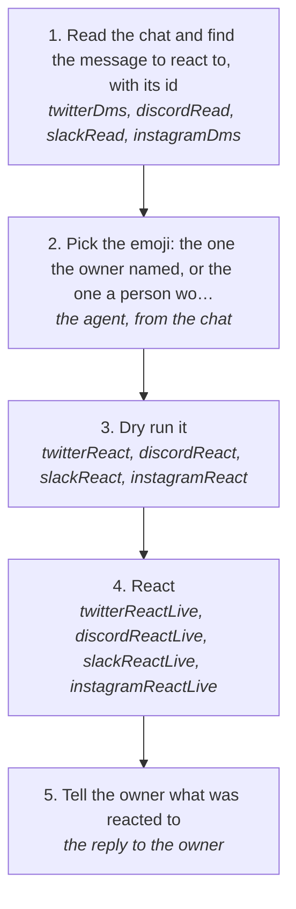

# Reacting to a message

React to someone's message with an emoji on X, Discord, Slack or Instagram, the way a person answers a moment without typing: a laugh at a joke, a fire on a win, a heart on good news. It goes through the platform's own engine and the account's one session, never the browser, and counts as a write (rule 140).

How the owner asks for it: "react to that", "heart his message", "put a 😂 on what she said", "send a reaction to <person>"

## Run it from a fresh context

Say: **"go on docs/useCases/inbox/reactions.md for <person or chat>"**. The agent reads this page and runs the steps.

## The steps

<!-- stepsDiagram: written by `bun run docs:build` from the steps table below, not edited by hand -->

<!-- /stepsDiagram -->

| # | Step | Tool | Done when |
| --- | --- | --- | --- |
| 1 | Read the chat and find the message to react to, with its id | `twitterDms` { with }, `discordRead` { channel }, `slackRead` { chat } or `instagramDms` { with }, with json | one message named with its author, time and id (a Slack message's id is its ts) |
| 2 | Pick the emoji: the one the owner named, or the one a person would put on that moment | the agent, from the chat | one emoji |
| 3 | Dry run it | `twitterReact`, `discordReact`, `slackReact` or `instagramReact` { account, chat, message, emoji } | the dry run names the chat and the message |
| 4 | React | `twitterReactLive`, `discordReactLive`, `slackReactLive` or `instagramReactLive` { account, chat, message, emoji, approvedBy: "matt", confirmLive: true } | the platform answers `sent` |
| 5 | Tell the owner what was reacted to | the reply to the owner | the message quoted with the emoji |

On Discord the chat flag is `channel` and on Instagram `thread`. `remove` takes the account's own reaction off. A refusal stops it, and nothing is tried again until the owner says so (rule 94).
