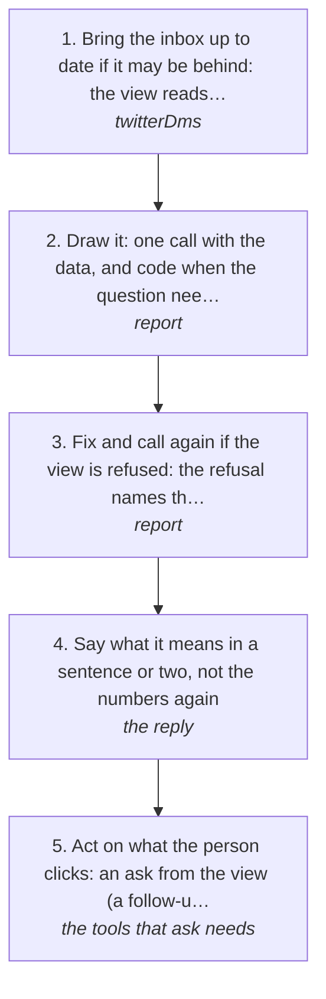

# Showing it as a view: generative UI in the chat

The owner wants to see something rather than read it. The agent builds a view for that one question (stats, charts, people, a page per person) and log draws it in the chat with the numbers read from log.db. It reads only and sends nothing. A question about one person gets that person; a question about the week gets the week.

How the owner asks for it: "show me who has been messaging me", "make a report of my DMs", "chart of who messages me most", "a dashboard of my inbox", "tell me about this person", "show me the people who messaged me this week", "visualise my DMs", "graph my messages"

## Run it from a fresh context

Say: **"go on docs/useCases/inbox/showMe.md"** and what to show. The agent reads this page and the `ui` guide (`getGuide({ topic: "ui" })`) and runs the steps.

## The steps

<!-- stepsDiagram: written by `bun run docs:build` from the steps table below, not edited by hand -->

<!-- /stepsDiagram -->

| # | Step | Tool | Done when |
| --- | --- | --- | --- |
| 1 | Bring the inbox up to date if it may be behind: the view reads log.db, which holds only what has been read (rule 160) | `twitterDms` { account } | the read is newer than the question |
| 2 | Draw it: one call with the data, and code when the question needs its own layout. `data: { dms: { source: "twitterDmsBySender", since: "30d" } }` alone draws the starter view; add `code`, a React view against the kit, for anything else | `report` { title, subtitle?, data, code? } | the answer says the view is shown, or carries it as text |
| 3 | Fix and call again if the view is refused: the refusal names the line or field | `report` | the view is shown |
| 4 | Say what it means in a sentence or two, not the numbers again | the reply | the owner has the point of it |
| 5 | Act on what the person clicks: an ask from the view (a follow-up, "draft a reply") arrives as their next message, and a point arrives as context | the tools that ask needs | the ask is done through its own gates |

## What to know

- **Where it draws.** Claude, ChatGPT and Cursor draw the view inline, because they are MCP Apps hosts. Claude Code, Codex and the rest get the same view as text, which is shown as it is.
- **The view never acts.** A button in it can only put a question into the chat or tell the agent what the person is pointing at. Every send still goes through its own tool, its dry run and `confirmLive` (rule 8).
- **One call is the norm.** The data comes in the same call, so the view needs no fetching. `useTool` inside a view is for data that changes while it is open, and it only calls read tools.
- **The starter view, and when to write your own.** With only data, the starter view shows the 30 days in four numbers (messages, the top 10's share, new this week, the busiest day), then the daily line, who messages most, and a table of people that opens a page for each. Write code when the question is narrower than that.
