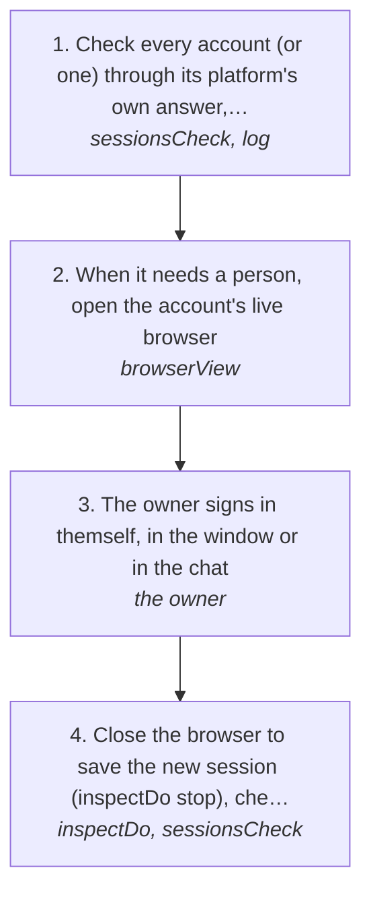

# Signing an account in: checking it, then the live browser

An account's session has run out, or it was never signed in. The agent checks it through the platform's own answer, and when it needs a person, it opens the account's own browser for the owner to sign in. On the owner's machine that browser is the window on their screen. From a remote runtime it is streamed into the chat as a live view, the same one the console's Connections page opens. The agent never types a password; the owner does.

How the owner asks for it: "sign in to my account", "is my x account logged in", "check my accounts", "log me back into instagram", "my session expired", "check the status of my accounts", "open the browser so I can sign in"

## Run it from a fresh context

Say: **"go on docs/useCases/inbox/signIn.md for <account>"**. The agent reads this page and runs the steps.

## The steps

<!-- stepsDiagram: written by `bun run docs:build` from the steps table below, not edited by hand -->

<!-- /stepsDiagram -->

| # | Step | Tool | Done when |
| --- | --- | --- | --- |
| 1 | Check every account (or one) through its platform's own answer, never a screen. A 401 or no saved session is "needs signing in", with its next step | `sessionsCheck` { platform?, account? } (the CLI's `log sessions check`, the console's Check) | each account signed in, needs signing in, stopped or unknown |
| 2 | When it needs a person, open the account's live browser. On the owner's machine it is the window on their screen; from a remote runtime an MCP Apps host shows it inline in the chat | `browserView` { account } | the browser is on the sign-in page, and the answer says where |
| 3 | The owner signs in themself, in the window or in the chat. Their clicks and typing reach the page only while it still asks for sign-in | the owner | the page has moved past sign-in |
| 4 | Close the browser to save the new session (`inspectDo` stop), check again, and only call it signed in when the platform says so (rule 25) | `inspectDo` { action: "stop" }, then `sessionsCheck` { account } | signed in |

## What to know

- **One path, two places.** The console's Connections page (Check and Sign in) and `browserView` in the chat use the same live browser, through `src/browser/viewer`. The console also records the check against the account.
- **Where it shows.** Inline sign-in needs an MCP Apps host (Claude, ChatGPT, Cursor). On the owner's own machine there is no stream: the window is on their screen. Any other host gets the text answer, which says where to sign in.
- **A checkpoint is a stop.** A captcha, a code the platform sends, or a security check is the owner's to answer. The agent waits and checks again, and never retries around it (rule 94).
- **Passwords stay with the owner.** The agent opens the browser and checks the result; it never types a password or a code.
