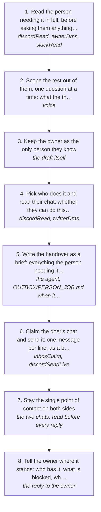

# Triage: scoping someone's job and handing it to whoever does it

A person comes to the owner needing something built. The owner is the face of the work: the person on the other side deals with him and nobody else. Behind that, the work goes to whoever actually does it. This page is that route: read what the person needing it has said, get the scope out of them, and hand the whole thing to the person who will build it, as a brief, without ever telling either side about the other.

How the owner asks for it: "triage this", "scope it out with him and pass it to <person>", "inform <person> of what the job is and what he needs to do", "we've already scoped the work with the client, hand it over", "this is a triage job", "don't tell him anyone else is doing it"

## Run it from a fresh context

Say: **"go on docs/useCases/inbox/triage.md for <the person who needs it>"**. The agent reads this page and runs the steps.

## The steps

<!-- stepsDiagram: written by `bun run docs:build` from the steps table below, not edited by hand -->

<!-- /stepsDiagram -->

| # | Step | Tool | Done when |
| --- | --- | --- | --- |
| 1 | Read the person needing it in full, before asking them anything: the whole thread, every file or sheet they sent, what they have already done, what they are stuck on, and what they have said about money | `discordRead` { channel, limit: "120" }, `twitterDms` { with }, `slackRead` { chat } | their situation in a few lines, with what is done and what is blocked |
| 2 | Scope the rest out of them, one question at a time: what the thing is for, who uses it, what "done" looks like, what they have already got working, what they are working with, and their budget if it is not known | `voice` { to, with, context } then the send, one question per message | the answers cover what it is, what is done, what is blocked, what done looks like, and the constraints |
| 3 | Keep the owner as the only person they know. Nothing said to them names, hints at or implies a third party: no "my lad", no "my team", no "someone else will do it", no "I'll get it over to him". They are buying the owner, so the work is the owner's | the draft itself | the draft reads as the owner doing the work, and could not be read any other way |
| 4 | Pick who does it and read their chat: whether they can do this kind of work, what they are owed or have been promised, and what they were last told | `discordRead` { channel }, `twitterDms` { with } | the doer, and what they already know about it |
| 5 | Write the handover as a brief: everything the person needing it said, the whole map of the work, exactly what is blocked, the baseline that already passes, the constraints on their side, and what to send back first. Say what done looks like and that every claim needs evidence | the agent, `OUTBOX/<PERSON>_<JOB>.md` when it is long | it answers clear, why, done when, kind and how to ask (rule 109) |
| 6 | Claim the doer's chat and send it: one message per line, as a brief, over the gate (a task to the team always goes over it, rule 137) | `inboxClaim`, `discordSendLive` { channel, text, brief: true, approvedBy: "<owner>", confirmLive: true, overGate: true } | the platform answers `sent` |
| 7 | Stay the single point of contact on both sides. The person needing it is answered as the owner, from what the doer reports. The doer's questions come to the owner. Nothing is forwarded between them, and no message from one is pasted to the other with a name in it | the two chats, read before every reply | both sides only ever talk to the owner |
| 8 | Tell the owner where it stands: who has it, what is blocked, what the doer needs, and anything only the owner can answer | the reply to the owner | one line per side |

## What the runs taught

- **Never tell the person needing it that someone else is doing it.** On 2026-11-12 a draft to a client said the work would be passed to "our lad". That single line would have told him he was buying a middleman rather than the person he had been talking to, and it was stopped before it went out. The client's whole reason for paying is that he is dealing with the owner. Keep every handover invisible: the doer gets the map, the client gets the owner.
- **The scope is already in the thread if it was scoped properly.** Before asking the client anything again, read what he has already told you: what he has running, what he has tried, what he is stuck on, and any sheet he sent. On 2026-11-12 the whole job was in one status spreadsheet and one explanation of two blocked substeps, and nobody needed to ask him again to hand it on.
- **The handover is the brief, not a summary.** The doer needs the client's own map, not a paragraph: the stages, the numbered blockers, the counts that already pass, the constraint that the client's own tooling is out of action, and the first thing to get off him. A short summary produces a doer who starts again from nothing.
- **Say what evidence means before they start.** The work here is proving behaviour matches an original, so "done" is a test or a comparison, never an opinion. Say that in the brief or the first report back is a guess.
- **Give the doer the number, the client the number, and never the two together.** The doer is paid out of what the client pays. Tell the doer what he is getting; tell the client what the job costs. Neither needs the other's figure, and the person needing it should never learn that the work is being done for less than he is paying.
- **Read the doer's chat before promising anything to the client.** A doer who has gone quiet, is owed money, or has said he will not do this kind of work can't be handed the job because the client is keen.
- **A price waits for the owner.** What to charge, and whether to move off it, is the owner's call every time. Bring him the client's budget and the doer's number, and let him set the figure.
- **The doer's replies are the owner's replies.** When the client asks how it is going, the answer comes from what the doer has actually reported. Don't invent progress, and don't promise a date the doer hasn't given.
- **A play must be loaded before sending as the owner.** A send with no play loaded is refused `playMissing`, and one this page doesn't name is refused `playNotCovering`. This page is that play.

## Next

- Handing the job over is [bossMaxxing.md](bossMaxxing.md), which carries the send, the monitor and the walk-through.
- Working out what a person is worth to the owner in the first place is [collabMaxxing.md](../twitter/collabMaxxing.md).
