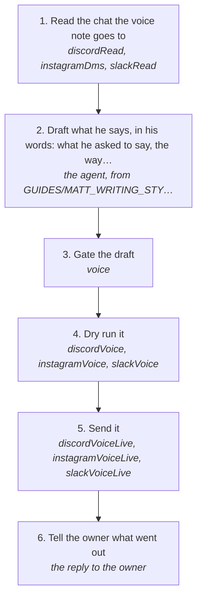

# Sending a voice note

Send someone a voice note in matt's own cloned voice, as the platform's own voice note, on Discord, Instagram or Slack. It is made from his words with Fish Audio and goes through the platform's engine and the account's one session, never the browser (rule 142). A voice note only goes out when matt asks for one.

How the owner asks for it: "send <person> a voice note saying …", "voice note him that …", "send a vn to the group saying …"

## Run it from a fresh context

Say: **"go on docs/useCases/inbox/voiceNote.md for <person or chat>"**. The agent reads this page and runs the steps.

## The steps

<!-- stepsDiagram: written by `bun run docs:build` from the steps table below, not edited by hand -->

<!-- /stepsDiagram -->

| # | Step | Tool | Done when |
| --- | --- | --- | --- |
| 1 | Read the chat the voice note goes to | `discordRead` { channel }, `instagramDms` { with } or `slackRead` { chat }, with json | the last messages both ways are known, and nothing new is waiting on matt that the note would talk over |
| 2 | Draft what he says, in his words: what he asked to say, the way he talks | the agent, from GUIDES/MATT_WRITING_STYLE.md and the chat | one short spoken line or two, as text |
| 3 | Gate the draft | `voice` { text, to } | the gate passes |
| 4 | Dry run it | `discordVoice`, `instagramVoice` or `slackVoice` { account, chat, text } | the dry run names the chat, the words and that the clone is ready |
| 5 | Send it | `discordVoiceLive`, `instagramVoiceLive` or `slackVoiceLive` { account, chat, text, approvedBy: "matt", confirmLive: true } | the platform answers `sent` with the message or file id |
| 6 | Tell the owner what went out | the reply to the owner | the words said, how long it ran, and where |

On Discord the chat flag is `channel`, on Instagram `with`. If there is no clone yet, `fishClone` lists matt's own voice notes and `fishClone` with apply makes it once. The voice note is made from text only, never from an audio file. A refusal stops it, and nothing is tried again until the owner says so (rule 94). X has no voice note.
