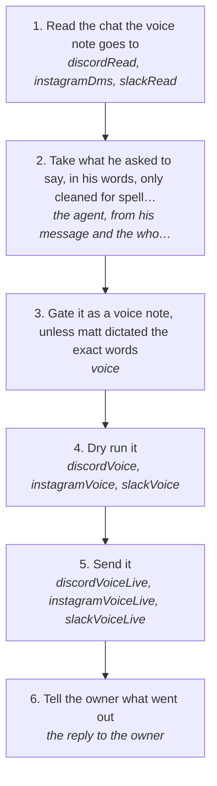

# Sending a voice note

Send someone a voice note in matt's own cloned voice, as the platform's own voice note, on Discord, Instagram or Slack. It is made from his words by the voice provider (Inworld by default, Fish Audio too) and goes through the platform's engine and the account's one session, never the browser (rules 142, 143). A voice note only goes out when matt asks for one.

How the owner asks for it: "send <person> a voice note saying …", "voice note him that …", "send a vn to the group saying …"

## Run it from a fresh context

Say: **"go on docs/useCases/inbox/voiceNote.md for <person or chat>"**. The agent reads this page and runs the steps.

## The steps

<!-- stepsDiagram: written by `bun run docs:build` from the steps table below, not edited by hand -->

<!-- /stepsDiagram -->

| # | Step | Tool | Done when |
| --- | --- | --- | --- |
| 1 | Read the chat the voice note goes to | `discordRead` { channel }, `instagramDms` { with } or `slackRead` { chat }, with json | the last messages both ways are known, and nothing new is waiting on matt that the note would talk over |
| 2 | Take what he asked to say, in his words, only cleaned for spelling; when he asks you to write it, read the whole chat and write it at the length he asks (a 40 s note is about 100 to 110 words), building on what they are talking about and never re-explaining what he already told them (rule 149) | the agent, from his message and the whole chat | the words to say, as text, at the length asked; not every note three short lines |
| 3 | Gate it as a voice note, unless matt dictated the exact words | `voice` { text, to, with, context, spoken: true } | the gate passes; if it refuses words the agent drafted, rewrite them; when matt dictated the exact words, skip this step and use `mattsWords` in steps 4 and 5 (rule 144) |
| 4 | Dry run it | `discordVoice`, `instagramVoice` or `slackVoice` { account, chat, text, mattsWords when they are his dictated words } | the dry run names the chat, the words and that the clone is ready |
| 5 | Send it | `discordVoiceLive`, `instagramVoiceLive` or `slackVoiceLive` { account, chat, text, mattsWords when they are his dictated words, approvedBy: "matt", confirmLive: true } | the platform answers `sent` with the message or file id |
| 6 | Tell the owner what went out | the reply to the owner | the words said, how long it ran, and where |

On Discord the chat flag is `channel`, on Instagram `with`. If there is no clone yet on the provider, `cloneVoice` lists matt's own voice notes and `cloneVoice` with apply makes it once; `cloneSpeak` says a test line. `provider` picks inworld or fishAudio (default LOG_VOICE_PROVIDER, else inworld). When matt dictates the exact words ("say this: …", or the words straight from his message), they are his own speech: pass `mattsWords`, which skips the voice gate's read (it grades speech as typed text and refuses it) and still refuses AI artifacts (rule 144). Words the agent drafted are never sent with `mattsWords`. The voice note is made from text only, never from an audio file. A refusal stops it, and nothing is tried again until the owner says so (rule 94). A send refused with `accountBehind` means the account's catch-up was refused: tell matt, and only on his word run `inboxResume` { platform, account, by: "matt" }, then send again once it has caught up (rule 150). On X it is `twitterVoice` / `twitterVoiceLive` { account, with: "<handle>", text }: an X Chat voice message, sent the way X Chat's own app sends one (the m4a encrypted with the conversation key, uploaded to the conversation's media store, one AUDIO attachment), with X Chat opened by the account's saved PIN; with no PIN it is refused `xchatPinMissing`, and matt saves it with `log twitter chat pin` in a terminal (rule 151). An X Chat group takes its id as `with` (`g` and digits), the same as a dm to the group takes it as `userId` (rule 153). A 401 from X while uploading is the upload built the wrong way, not a refusal: it is fixed and sent again in the same turn, never left for later. The parts go to the `resume_upload_url` X's Initialize answers, under the same message id the voice note is then sent with. Only a rate limit, a block or the governor's cap is a refusal that stops (rule 94); when matt says to reset the cap, it is reset and the catch-up resumed with `inboxResume`.
