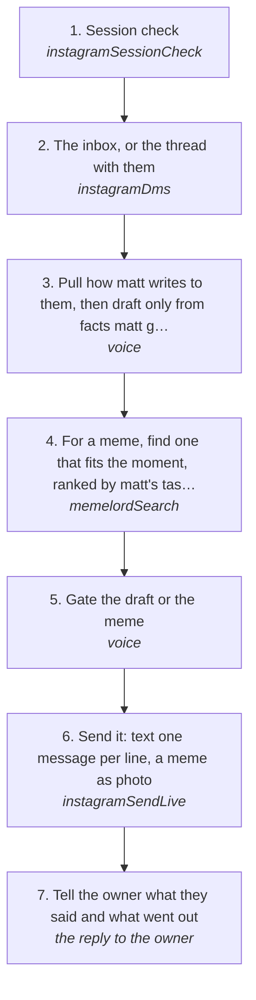

# Reading and answering an Instagram DM

Read what someone wrote to the account on Instagram and answer it in matt's voice, with text or a meme, on the account's own session through vendor/instagrapi. No browser, ever (rule 128).

How the owner asks for it: "read my instagram dms", "what did <someone> say on instagram", "reply to <someone> on instagram", "send <someone> a meme on instagram"

## Run it from a fresh context

Say: **"go on docs/useCases/instagram/dmReply.md for <someone>"**. The agent reads this page and runs the steps.

## The steps

<!-- stepsDiagram: written by `bun run docs:build` from the steps table below, not edited by hand -->

<!-- /stepsDiagram -->

| # | Step | Tool | Done when |
| --- | --- | --- | --- |
| 1 | Session check | `instagramSessionCheck` { account } | `loggedIn` as the account's handle |
| 2 | The inbox, or the thread with them | `instagramDms` { account }, then `instagramDms` { account, with: "<handle>" } | their latest message and what came before it |
| 3 | Pull how matt writes to them, then draft only from facts matt gave | `voice` { to: "<handle>", with: "<who>", context } (no text) | a draft that answers what they said |
| 4 | For a meme, find one that fits the moment, ranked by matt's taste, and save its picture | `memelordSearch` { query: ["<the moment>"], method: "fulltext", type: "meme" } | a template that fits, saved as a JPEG |
| 5 | Gate the draft or the meme | `voice` { to, with, context, text: "<draft or media url>" } | it passes |
| 6 | Send it: text one message per line, a meme as `photo` | `instagramSendLive` { account, with: "<handle>", text and/or photo: "<file>", approvedBy: "matt", confirmLive: true } | Instagram answers each message with its id |
| 7 | Tell the owner what they said and what went out | the reply to the owner | both quoted with their times |

New messages arrive by themselves: the inbox hook keeps `log instagram watch --inbox` open for every signed-in Instagram account on Instagram's realtime connection and puts each new DM in front of the agent (`>>> NEW INSTAGRAM MESSAGE`).

## What the runs taught

- **Never the browser.** On 2026-11-04 a meme went out through the account's AdsPower browser and matt said that is not the way: read, send and watch are the engine's (rule 128).
- **A meme goes as the picture.** Memelord answers with a media URL; save it as a JPEG and send it as `photo`, never the link.
- **Pick from the top of the taste ranking, with judgement.** A template built on a stereotype is skipped even when it ranks first.
