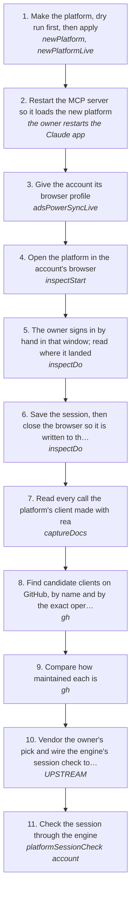

# Bringing a new platform up, then vendoring its client

Make a platform log-cli doesn't have yet, open it in the account's [AdsPower](https://www.adspower.com/share/pD25Iu) browser, sign in by hand, keep the session, read what its own client called with rea, then find the open-source client that speaks the same calls and vendor it so the platform works on the direct-API engine. Instagram was the first one done this way.

How the owner asks for it: "make a new platform via the MCP for <platform>", "open <platform> in AdsPower", "find me via the gh api the most likely to go into the vendor", "make it work"

## Run it from a fresh context

Say: **"go on docs/useCases/instagram/newPlatform.md for <platform>"**. The agent reads this page and runs the steps.

## The steps

<!-- stepsDiagram: written by `bun run docs:build` from the steps table below, not edited by hand -->

<!-- /stepsDiagram -->

| # | Step | Tool | Done when |
| --- | --- | --- | --- |
| 1 | Make the platform, dry run first, then apply | `newPlatform` { name, hosts, home, cookieDomain, sessionCookies }, then `newPlatformLive` with the same and confirmLive: true | every file written and every syntax-tree edit landed, `check:platforms` passes |
| 2 | Restart the MCP server so it loads the new platform | the owner restarts the Claude app | `adsPowerSync` sees the platform's accounts |
| 3 | Give the account its browser profile | `adsPowerSyncLive` { account: "<account>", confirmLive: true } | the account has an `adsPowerProfileId` |
| 4 | Open the platform in the account's browser | `inspectStart` { account, detach: true, url: "<home>", goal } | the gate and self-check passed and the home page is open |
| 5 | The owner signs in by hand in that window; read where it landed | `inspectDo` { action: "snapshot" } | the platform's own answer shows the account signed in |
| 6 | Save the session, then close the browser so it is written to the account | `inspectDo` { action: "saveState" }, then `inspectDo` { action: "stop" } | the account's cookies hold the platform's session cookies |
| 7 | Read every call the platform's client made with rea | `captureDocs` | `docs/platforms/<platform>/` has a doc per request, each read by rea |
| 8 | Find candidate clients on GitHub, by name and by the exact operations recorded | `gh api search/repositories`, `gh api search/code` for the recorded operation names | a short list, each with stars, licence and what API it speaks |
| 9 | Compare how maintained each is | `gh api repos/<repo>/commits`, releases, closed issues in the last 30 and 90 days | a table the owner picks from |
| 10 | Vendor the owner's pick and wire the engine's session check to it | `vendor/<client>` with `UPSTREAM`, `python/<platform>Api/engine.py` ping, the route's library, the platform's spec | the session check passes offline tests and the gates |
| 11 | Check the session through the engine | `<platform>SessionCheck` { account } | the platform's own answer: `loggedIn` as the account's handle |

## What the runs taught

- **No proxy unless the owner says so.** A new platform defaults to needing a proxy in the account's home country. An account with no proxy and no home can't open until the platform is set to `proxy: "none"` or the account gets both.
- **The MCP server keeps the old platform list until it restarts.** Sync and inspect on a platform made in the same session see none of its accounts; restart the app, never run `log` by hand around it.
- **Outside the account's hours is the owner's call.** `inspectStart` refuses with `outsideActiveHours`; `bypass` with `confirmBypass` only when the owner says to open it now.
- **The session reaches the account only when the browser closes.** `saveState` writes the browser's state to the run; `stop` saves it to the account.
- **Search by the operations, not only by name.** Searching GitHub code for the recorded GraphQL operation names finds the clients that speak the same web API; a name search mostly finds mobile-API clients and bots.
- **The client goes out like a browser.** Prefer the client's own curl_cffi transport, as X, LinkedIn and Slack do.
