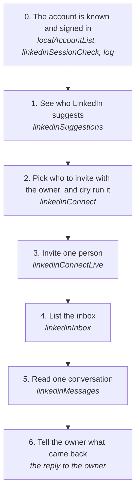

# Growing a LinkedIn network and reading its inbox

Invite the people LinkedIn suggests on My Network, slowly, and read the account's conversations, from its own session with no browser.

How the owner asks for it: "connect with people on linkedin", "who does linkedin suggest", "read my linkedin messages", "what did <someone> say on linkedin"

## Run it from a fresh context

Say: **"go on docs/useCases/linkedin/network.md"**, with who to invite or whose messages to read. The agent reads this page and runs the steps.

## The steps

<!-- stepsDiagram: written by `bun run docs:build` from the steps table below, not edited by hand -->

<!-- /stepsDiagram -->

| # | Step | Tool | Done when |
| --- | --- | --- | --- |
| 0 | The account is known and signed in | `localAccountList` {}, then `linkedinSessionCheck` { account }; if it isn't, the owner runs `log linkedin cookies save --account <publicId>` in a terminal | `loggedIn` as that profile |
| 1 | See who LinkedIn suggests | `linkedinSuggestions` { account } | the people on My Network, each with a public id |
| 2 | Pick who to invite with the owner, and dry run it | `linkedinConnect` { account, profile } | the dry run names the person and the pace left today |
| 3 | Invite one person | `linkedinConnectLive` { account, profile, approvedBy: "<owner>", confirmLive: true } | LinkedIn sets the invitation to Pending |
| 4 | List the inbox | `linkedinInbox` { account } | the 20 newest conversations, who wrote last and when |
| 5 | Read one conversation | `linkedinMessages` { account, with } or { account, conversation } | every message in it, attachments and voice messages marked |
| 6 | Tell the owner what came back | the reply to the owner | who was invited, or what they said, with times |

## What the runs taught

- **Only people LinkedIn suggests.** Connect sends the request My Network's own Connect button sends, read out of the page for that person. Someone not suggested is `profileNotSuggested`.
- **Slow on purpose.** One invitation a run, 15 minutes apart, at most 5 in 24 hours (`connectTooSoon`, `connectDailyCap`). The pace is checked before the governor counts a write, so a refused one costs nothing.
- **LinkedIn's "invitation not sent" is a stop.** It is `connectRefused` and counts as a throttle: nothing more goes out until the owner says so (rule 94).
- **Reading marks nothing seen.** The inbox and a conversation are read with the calls the web client makes to list and open them, and none of the calls that mark a conversation seen.
