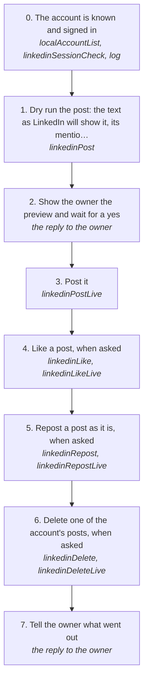

# Posting on LinkedIn, liking or reposting, and taking a post down

Post text, an image or mentions from the account's own session, like or repost someone's post, or delete one of the account's own posts, each the way LinkedIn's own web client does it, with no browser.

How the owner asks for it: "post this on linkedin", "put this up on linkedin with the picture", "like <someone>'s post on linkedin", "repost that on linkedin", "delete that linkedin post"

## Run it from a fresh context

Say: **"go on docs/useCases/linkedin/posts.md with <the text or the post>"**. The agent reads this page and runs the steps.

## The steps

<!-- stepsDiagram: written by `bun run docs:build` from the steps table below, not edited by hand -->

<!-- /stepsDiagram -->

| # | Step | Tool | Done when |
| --- | --- | --- | --- |
| 0 | The account is known and signed in | `localAccountList` {}, then `linkedinSessionCheck` { account }; if it isn't, the owner runs `log linkedin cookies save --account <publicId>` in a terminal | `loggedIn` as that profile |
| 1 | Dry run the post: the text as LinkedIn will show it, its mentions and the image | `linkedinPost` { account, text, image } | the preview, with each `@[Name]` matched to one person |
| 2 | Show the owner the preview and wait for a yes | the reply to the owner | the owner says post it |
| 3 | Post it | `linkedinPostLive` { account, text, image, approvedBy: "<owner>", confirmLive: true } | LinkedIn answers with the activity id and the post's URL |
| 4 | Like a post, when asked | `linkedinLike` { account, post }, then `linkedinLikeLive` { account, post, approvedBy: "<owner>", confirmLive: true } | LinkedIn's answer sets the post's reaction |
| 5 | Repost a post as it is, when asked | `linkedinRepost` { account, post }, then `linkedinRepostLive` { account, post, approvedBy: "<owner>", confirmLive: true } | LinkedIn commits the repost with its success toast |
| 6 | Delete one of the account's posts, when asked | `linkedinDelete` { account, activity }, then `linkedinDeleteLive` { account, activity, approvedBy: "<owner>", confirmLive: true } | LinkedIn answers that the post is gone |
| 7 | Tell the owner what went out | the reply to the owner | the post's URL, or what was liked or deleted |

## What the runs taught

- **The text is LinkedIn's, not ours.** A post goes out as LinkedIn's composer sends it: LaunchCreatePost then CreatePost for text, and the image upload and RegisterImageMedia first for a picture. CreatePost's activity id decides that it posted.
- **Mentions are looked up, never guessed.** `@[Name]` goes through LinkedIn's own mention search and needs exactly one match. Two or none refuse the post (`mentionAmbiguous`, `mentionNotFound`), so the dry run is where they get fixed.
- **The composer's follow-ups run after the post.** When LinkedIn refuses one, the post is still live, the rest are skipped and nothing is retried (rule 94).
- **A like counts only when LinkedIn says so.** The answer must commit the post's reaction state; otherwise it is `likeUnconfirmed`.
- **A repost counts only with LinkedIn's success toast.** The answer must commit it and show the success toast; otherwise it is `repostUnconfirmed`.
- **Writes are few.** A LinkedIn account writes at most 10 times a day. Every write waits for the owner's yes.
