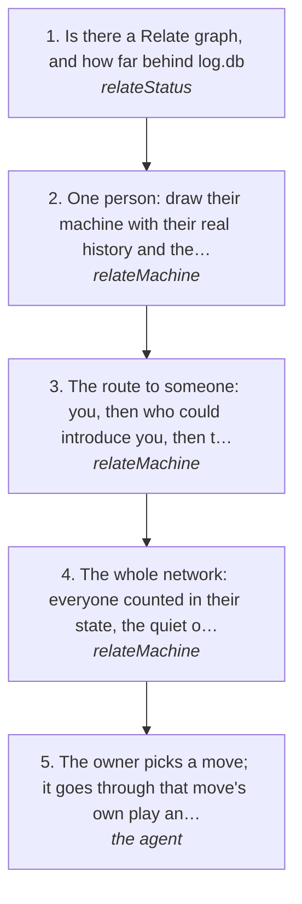

# Relationship state machine

Where you stand with someone, drawn as a state machine in the stately look: the states a relationship moves through (new, follows you, talks to your followers, engaged with you, you reached out, in conversation), the moves between them (follow, like their post, reply, DM, intro, they replied), each labelled with the log tool that makes it. The person's real history from log.db is the path taken, timestamped; where it stands now is highlighted, and the next move is the outgoing transition. The same machine shows the route to someone through the people you know, and your whole network with a count in each state.

How the owner asks for it: "where am I with <person>", "how do I reach <person>".

## Run it from a fresh context

Say: **"go on docs/useCases/network/relationshipMachine.md"**. The agent reads this page and runs the steps. Nothing is sent: every step reads log.db and the Relate graph.

## The steps

<!-- stepsDiagram: written by `bun run docs:build` from the steps table below, not edited by hand -->

<!-- /stepsDiagram -->

| # | Step | Tool | Done when |
| --- | --- | --- | --- |
| 1 | Is there a Relate graph, and how far behind log.db | `relateStatus` {} | its event number; no graph means `relateBuild` {} first |
| 2 | One person: draw their machine with their real history and the next move | `relateMachine` { person } | the machine is shown, or the text says where they stand and the next move |
| 3 | The route to someone: you, then who could introduce you, then them | `relateMachine` { to } | the best connector is the highlighted next move |
| 4 | The whole network: everyone counted in their state, the quiet ones flagged | `relateMachine` { view: "network" } | a count per state |
| 5 | The owner picks a move; it goes through that move's own play and gates, never from the view | the agent | the owner's yes for each send |

## What to know

- **It is a block.** `relateMachine` returns a `stateMachine` block in the `report` view, so any report can carry one too: `report` { title, blocks: [{ type: "stateMachine", states, transitions }] }.
- **In a Hermes GenUI page.** `relateMachine` { person, form: "genui" } returns the same block as JSON; pass it unchanged as one of `show_blocks`' blocks, between text and callouts that make the point. Each state's `explain` (where they stand, why, the next move) shows on the node, on hover and in the panel on a click.
- **Light and dark** follow the host's theme; the colours, sizes and fonts all live in `src/relate/machine/theme.ts`.
- **Where the states come from:** follows and likes from log.db's interactions (their first time), DMs from the first message each way, groups and circles from the graph, and the network map's ring when log.db has nothing else.
- A DM you sent to someone who never wrote in it only shows once the chat lists them as a member.
- Rebuild the graph (`relateBuild`) after new conversations so the machine moves on.

## Related

- Up: [All use cases](../README.md)
- [Who to talk to next](whoToTalkTo.md)
- [The Relate graph](../../relateGraph.md)
- [Design research](../../decisions/relateApp/research.md)
