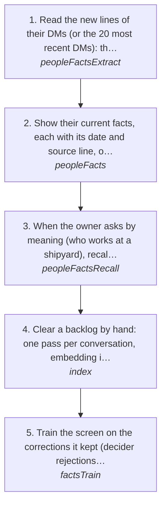

# Person facts

log keeps what people said that stays true (their job, where they work, what they are building, what the owner promised them, money owed) as events in log.db, each with the exact message it came from. A draft that says a promise again is held by the voice gate as already promised, and the person card, the conversation card and the Relate graph show the current facts.

How the owner asks for it: "what did I promise them", "what do I know about them".

## Run it from a fresh context

Say: **"go on docs/useCases/people/facts.md"**. The agent reads this page and runs the steps. Nothing is sent: extraction writes events to log.db only.

## The steps

<!-- stepsDiagram: written by `bun run docs:build` from the steps table below, not edited by hand -->

<!-- /stepsDiagram -->

| # | Step | Tool | Done when |
| --- | --- | --- | --- |
| 1 | Read the new lines of their DMs (or the 20 most recent DMs): the local model marks lines that carry a fact or a promise, the decider decides each marked line (ADD, SUPERSEDE or NOOP against their current facts), and each fact is recorded with its source message | `peopleFactsExtract` { who } | the facts added and the repeats, per person |
| 2 | Show their current facts, each with its date and source line, open promises first | `peopleFacts` { who } | the list, or none yet |
| 3 | When the owner asks by meaning ("who works at a shipyard"), recall from the graph with the evidence line | `peopleFactsRecall` { question } | the nearest current facts with the message each came from |
| 4 | Clear a backlog by hand: one pass per conversation, embedding it for search, rebuilding the owner's voice for that chat and person, then screening every room kind for facts | `index` { platform, account, limit, only } | conversations queued, embedded, voiced, screened and decided, with p50 and p95 |
| 5 | Train the screen on the corrections it kept (decider rejections, accepted facts, the owner's own corrections), on CPU | `factsTrain` { epochs } | accuracy on the held-out slice before and after, and the new pinned revision |

## What to know

- A correction is a new fact in the same slot; the old one is kept with when it stopped being current, never edited. `peopleFacts` { who, all: true } shows both.
- A fact on one account moves to the person when the owner links the accounts.
- New DM lines are marked as they arrive; marks wait until the extract runs. With no decider key it refuses with `factDeciderUnavailable` and the marks stay queued.
- Promises the owner made are what the voice gate checks: a draft that repeats an open one is refused as already promised, with the line and its date, so follow up on it instead.

## Related

- Up: [All use cases](../README.md)
- [The Relate graph](../../relateGraph.md)
- [Person facts spec](../../specs/personFacts.md)
