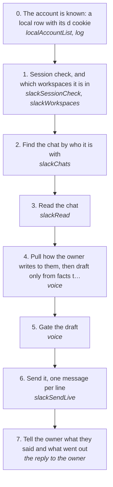

# Reading and answering a Slack DM

Read what someone wrote to the account on Slack and answer it in the owner's voice, on the account's own session, with no browser.

How the owner asks for it: "read the messages with <someone> on slack", "reply to <someone> on slack", "what did <someone> say in <workspace>"

## Run it from a fresh context

Say: **"go on docs/useCases/slack/dmReply.md for <someone>"**. The agent reads this page and runs the steps.

## The steps

<!-- stepsDiagram: written by `bun run docs:build` from the steps table below, not edited by hand -->

<!-- /stepsDiagram -->

| # | Step | Tool | Done when |
| --- | --- | --- | --- |
| 0 | The account is known: a local row with its `d` cookie | `localAccountList` {}; if missing, the owner runs `log slack cookies save --account <name>` in a terminal | the account is listed |
| 1 | Session check, and which workspaces it is in | `slackSessionCheck`, then `slackWorkspaces` | `loggedIn`, with the workspace's domain |
| 2 | Find the chat by who it is with | `slackChats` { account, workspace } | one DM or group with that person |
| 3 | Read the chat | `slackRead` { account, workspace, chat, limit } | their latest message and what came before it |
| 4 | Pull how the owner writes to them, then draft only from facts the owner gave | `voice` { to, with, context } (no text) | a draft that answers what they asked |
| 5 | Gate the draft | `voice` { to, with, context, text } | it passes |
| 6 | Send it, one message per line | `slackSendLive` { account, workspace, chat, text, approvedBy: "<owner>", confirmLive: true } | Slack answers each line with its ts |
| 7 | Tell the owner what they said and what went out | the reply to the owner | both quoted with their times |

New messages arrive by themselves: the inbox hook keeps `log slack watch --inbox` open for every signed-in account and puts each new DM, group message or mention in front of the agent (`>>> NEW SLACK MESSAGE`).

## What the runs taught

- **Read the chat before sending.** The voice gate inside `slackSendLive` reads the chat's context from the .db, not from Slack (rule 137). `slackRead` stores what it reads there as backfill, so step 3 is what gives the gate the chat's history. Once a thank-you was refused three times while the .db held only 2 of the other person's messages, and the gate read it as a cold first message with an ask in it. Backfilled history is never shown as new messages.
- **Send by who it is with.** Give `chat` as the person (their name or handle), not only the D… id, so the gate matches the owner's history with them by name.
- **Don't stack messages on a chat the owner already answered.** When the owner's own messages are the newest in the chat (the owner has already said thanks), a third message is refused as not the owner's voice, and it reads like it. Answer it with a reaction instead (`slackReactLive`, [inbox/reactions](../inbox/reactions.md)), or leave it. A 🙏 on a contact's short thank-you went out this way.
