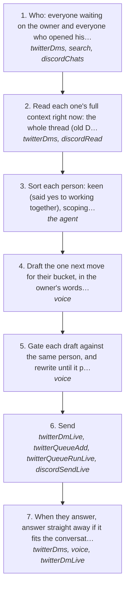

# Collab maxxing: turn open conversations into collabs

Network maxing gets people talking to the owner. Collab maxxing turns those conversations into something you can work on together. Everything the owner builds is open source and he earns nothing from it. So the collab is the deal: he builds their system with them and makes content about doing it, they get the outcome, and they back the work. Money is the last thing in the conversation, never the first. It comes as a small ask once they're keen, or a retainer the owner prices himself.

The owner runs it across everyone already talking to him, the new people from [networkMaxing.md](networkMaxing.md), the friends with open threads and the missed openings nobody answered. On X it works the same in the old DM inbox and X Chat, and on Discord it works through `discordRead` and `discordSendLive`.

How the owner asks for it: "position a collab first then be like just a few quid so i can make a video about it", "start network maxxing and collab maxxing and trying to see what hes doing get him to reveal it all", "follow up on deepman and the other people, small commitment from deals, not just new people but already open convos", "respond with the collabmaxxing", "selling the outcome", "let him name it", "check in with lior whats good there he is keen but isnt liquid", "just be nice to them there the poor people", "ask ben if i could become a contributor", "look on my twitter for missed opportunities".

## Run it from a fresh context

Say: **"go on docs/useCases/twitter/collabMaxxing.md"**, and say who it's for this round (everyone open, the missed openings, one person). The agent reads this page and [README.md](README.md), loads `getGuide({ topic: "xSending" })` (and `getGuide({ topic: "discord" })` for Discord), and runs the steps.

## The steps

<!-- stepsDiagram: written by `bun run docs:build` from the steps table below, not edited by hand -->

<!-- /stepsDiagram -->

| # | Step | Tool | Done when |
| --- | --- | --- | --- |
| 1 | Who: everyone waiting on the owner and everyone who opened his last message, plus the missed openings. The missed openings are threads in the local store where they wrote last, or said something with a deal in it (hiring, a retainer, a price, "lets do it", an intro), and nobody answered. Keep the real people. Drop spam, cold pitches at the owner, group banter and notification bots | `twitterDms` { account, waiting: true, limit: "200" }, `search` { query }, `discordChats` | a short list: who, what they said last, and what the opening is |
| 2 | Read each one's full context right now: the whole thread (old DM and X Chat merged) and what they did on the owner's posts. On Discord, read the chat | `twitterDms` { account, with: "<handle>" }, `discordRead` | what they do, what they asked, and where the talk stands |
| 3 | Sort each person: **keen** (said yes to working together), **scoping** (has a need, hasn't said what), **skint** (said they can't pay), **friend** (crew, not a lead), **cold** (never talked). Each gets a different next message | the agent | one bucket per person |
| 4 | Draft the one next move for their bucket, in the owner's words for that person. **Scoping:** get them talking about what they do, how they sell and what they spend, with one question and often none. Ask what it looks like in 6 months. **Keen:** position the collab: it's all open source and free, you get the outcome, I make content about us doing it, would be lit to properly collab. Let them lead on what's first. **Skint:** be nice, no pressure, ask nothing about money, and leave the door open. **Friend:** react to what they said and share something of the owner's, never a script. **Cold:** the opener only ([networkMaxing.md](networkMaxing.md) step 10) | `voice` { to, with, context } | one draft per person |
| 5 | Gate each draft against the same person, and rewrite until it passes. A draft with a price, a retainer figure or a meeting waits for the owner: say what it would offer and let him give the number | `voice` { to, with, context, text } | the gate passes, or it's held for the owner with why |
| 6 | Send. One person: `twitterDmLive`. Two or more: the account's one queue, never a loop. On Discord: `discordSendLive`. The recipient is the numeric X user id. A handle is refused (`userIdInvalid`), so look it up first with [treg](https://treg.to/?ref=matthewdonse-aebsh)'s X profile read | `twitterDmLive` { userId, text, approvedBy, confirmLive: true }, or `twitterQueueAdd` and `twitterQueueRunLive`, or `discordSendLive` | the platform's answer is `sent` |
| 7 | When they answer, answer straight away if it fits the conversation (rule 108). When they're keen, the ask comes next: a few quid so the owner can make a video about it, or the retainer he priced. Then tell the owner what they said and what went out | `twitterDms` { with }, `voice`, `twitterDmLive` | the owner knows where each collab stands |

## What to know

- **The pitch, in the owner's words:** he builds open source and earns nothing from it, so collab so he can make a few quid, they get the outcome and he makes content about it. Frame it as joining the crew: his systems find, warm and book people, and someone still has to be on the other end of the call.
- **Sell the outcome, not the tool.** Ask what they'd want in 6 months and how it should feel. "Let him name it" means let them say what it's worth before the owner sets a number. A price or retainer is always the owner's call (rule 108). On 2026-11-03 Vaughn's retainer was held at the owner's 700 once it came out that Vaughn charges $15 a site.
- **Learn the model from people who run it.** On 2026-11-02 @shaw_gtm explained his: a big retainer up front, then a smaller retainer plus rev share. Some clients pay a small retainer plus rev share from day one, because he owns most of their sales process. Answer people who explain things like that, because it's how the owner prices his own collabs.
- **Never run the script on a friend.** On 2026-11-03 Lior worked out the chat was automated. What gave it away: a discovery-question ladder in 15 minutes, money asked before he raised it, every reply 40 to 90 s after his message and ending on a question, and a queued line landing over his question. With friends: one question at most, vary the timing and length, never send while their newer message is unanswered, and hand money talk to the owner.
- **Skint is not a no.** When someone says they can't pay, don't push for a figure. Lior: "keen but isnt liquid". The check-in said no rush, when the money's there it's there, still keen to build something, and he came back with "Let's do it matt" and offered to make content on it for the French market. @cryptogemguy said he's in survive mode, and got a kind message and nothing asked.
- **Collabs go both ways.** Asking to contribute to someone else's open source counts too. On 2026-11-03 the owner asked Ben (@bensenescu, OpenSEO, now EveryApp) to be a contributor, opening on Ben's own reply to his post.
- **Missed openings are the cheapest wins.** Someone who explained their model, said they're hiring, or said "lets do it", and never got an answer. Find them in step 1 before reaching for new people.
- Never ask the people the owner has ruled out for money (in the agent memory). Never send the same message twice: check the thread before a resend. Memes go as media, never as a raw link.
- Every send counts against the account's writes for the day, each line one write. Space people out and never act in quick succession. Any refusal stops the run (rule 94).
