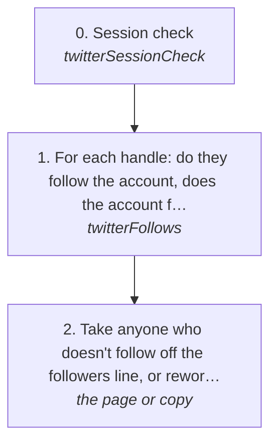

# Checking who really follows you

Before a slide, a page or a message says someone follows you (or that you follow them), check it live on X. Engaging with you isn't following you. This page reads it on the account's own session and sends nothing.

## Run it from a fresh context

Say: **"go on docs/useCases/twitter/followers.md for <handles>"**, or "for everyone named on <page>". The agent then reads this page and [README.md](README.md) and runs the steps.

## The steps

<!-- stepsDiagram: written by `bun run docs:build` from the steps table below, not edited by hand -->

<!-- /stepsDiagram -->

| # | Step | Tool | Done when |
| --- | --- | --- | --- |
| 0 | Session check | `twitterSessionCheck` | `loggedIn` |
| 1 | For each handle: do they follow the account, does the account follow them | `twitterFollows` { account, handles: "a,b,c" } | one answer per handle, from X |
| 2 | Take anyone who doesn't follow off the "followers" line, or reword the line | the page or copy | every name on it is true today |

Handles come from research or from the owner, never guessed (rule 53). The read is 1.5 s per handle, so a long list takes a minute.

## What the runs taught

- **People who engage aren't always followers.** A slide naming the account's "circle" listed people who had only engaged; two of them didn't follow. Every named follower now gets this check first.
- **The full follower list comes from the account's own session,** not from who engaged.

## Reading the list

`log twitter followers --account <a>` (MCP `twitterFollowers`) reads the account's full follower list on its own session, on the direct-API engine.
