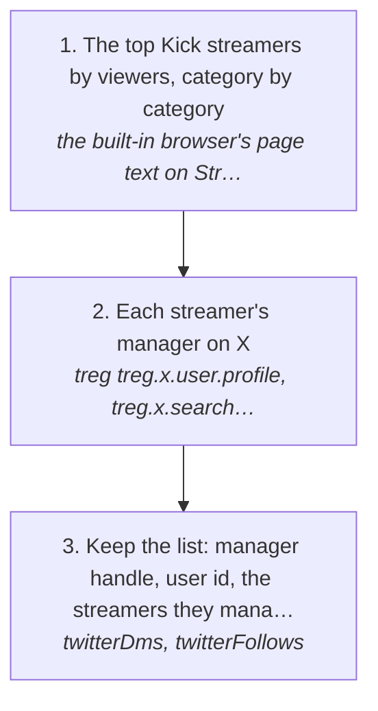
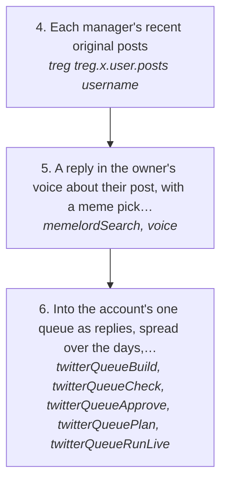
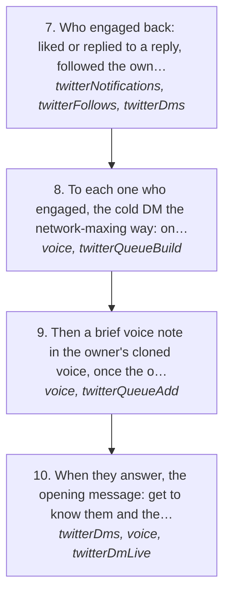

# Manager maxxing: the managers of the biggest Kick streamers

The owner's go-to-market, in his words (https://x.com/matthewsoldit/status/2118285429674017268): "find every single kick streamers managers on twitter, reply guy them for a few days then cold dm them to use log and show claviculars twitter". The pitch, once they're talking: if Claude Code explains the sponsor deals a streamer does, with tracked links, sign-up rates go up, which means more affiliate money. Letting AI use your social media increases your surface area of luck.

The people this is for (the ICP) are the managers of Kick streamers, category by category, starting with the streamers with the most viewers. It runs on the network-maxing logic ([networkMaxing.md](networkMaxing.md)): every touch is about them and what they're doing, and the ask comes only once they're talking.

How the owner asks for it: "manager maxxing", "find every kick streamer's manager on twitter", "reply guy the kick managers with memes", "the managers that engaged, send them their tweet, a message and a voice note".

## Run it from a fresh context

Say: **"go on docs/useCases/twitter/managerMaxxing.md for <category, or all of them>"**. The agent reads this page, [README.md](README.md) and [networkMaxing.md](networkMaxing.md), loads `getGuide({ topic: "xSending" })` and `getGuide({ topic: "extensions" })`, and runs the steps.

## The steps

### Find the managers

<!-- stepsDiagram: written by `bun run docs:build` from the steps table below, not edited by hand -->

<!-- /stepsDiagram -->

| # | Step | Tool | Done when |
| --- | --- | --- | --- |
| 1 | The top Kick streamers by viewers, category by category. StreamerStats lists them without a login: the categories at `streamerstats.com/kick/categories`, each category's top channels at `streamerstats.com/kick/categories/<slug>` (live now and the last 30 days), and each channel's page at `streamerstats.com/kick/channels/<name>` links the streamer's X. Streams Charts is behind Cloudflare and KickStats loads its tables with JavaScript, so neither reads from a fetch | the built-in browser's page text on StreamerStats (rule 53: the source is named) | per category, the top streamers with their average viewers and their X handle |
| 2 | Each streamer's manager on X. First the streamer's own bio and link ("mgmt", "business", "managed by"). Then an X search for the streamer with "manager", "management", "managed by" or "talent", and the people those posts name. A candidate is only a manager when their own profile says so (bio, pinned post, or the streamer naming them); a fan joking about "his manager" is not one | treg `treg.x.user.profile`, `treg.x.search.posts` { q } | each streamer's manager, confirmed from their own profile, with how it was confirmed |
| 3 | Keep the list: manager handle, user id, the streamers they manage, the category, the streamers' viewers, and how each was confirmed. Drop anyone the owner already talks to | `twitterDms` { account, with }, `twitterFollows` | `~/.logCli/managerMaxxing/managers.json` |

### Reply guy them for a few days, with memes

<!-- stepsDiagram: written by `bun run docs:build` from the steps table below, not edited by hand -->

<!-- /stepsDiagram -->

| # | Step | Tool | Done when |
| --- | --- | --- | --- |
| 4 | Each manager's recent original posts | treg `treg.x.user.posts` { username } | a post per manager worth replying to |
| 5 | A reply in the owner's voice about their post, with a meme picked to his taste for that moment, uploaded as media. Gate every reply | `memelordSearch`, `voice` { to, context, text } | every reply passes |
| 6 | Into the account's one queue as replies, spread over the days, a few minutes apart (rules 104, 107). Each reply likes the post and follows them first | `twitterQueueBuild` { action: "reply" }, `twitterQueueCheck`, `twitterQueueApprove`, `twitterQueuePlan`, `twitterQueueRunLive` | X's answer is `sent` |

### Who engaged, then the DM

<!-- stepsDiagram: written by `bun run docs:build` from the steps table below, not edited by hand -->

<!-- /stepsDiagram -->

| # | Step | Tool | Done when |
| --- | --- | --- | --- |
| 7 | Who engaged back: liked or replied to a reply, followed the owner, or messaged him | `twitterNotifications` { account }, `twitterFollows`, `twitterDms` { account, with } | the managers who engaged |
| 8 | To each one who engaged, the cold DM the network-maxing way: one of their own tweets forwarded first, then one line about it. The opener only, never the ask (rule 98) | `voice` { to, context, text }, then `twitterQueueBuild` { action: "dm" } | every opener passes |
| 9 | Then a brief voice note in the owner's cloned voice, once the openers have gone: one spoken question that goes a step further on their tweet (rule 156) | `voice` { to, context, text, spoken: true }, then `twitterQueueAdd` { action: "voice" } | X's answer is `sent` for each voice note |
| 10 | When they answer, the opening message: get to know them and the streamers they run, then, in the conversation, log: Clavicular's X as the example, Claude Code explaining sponsor deals with tracked links, more sign-ups, more affiliate money | `twitterDms` { account, with }, `voice`, `twitterDmLive` | the conversation is going |

## What to know

- **The ICP is the manager, not the streamer.** A streamer only matters here as the way to their manager.
- **Never guess a manager.** Searching X for "<streamer> manager" brings up jokes and fans as well as real managers (on 2026-11-05 "clavicular manager" gave both). Only a profile that says so counts.
- **Reply guy first, for a few days,** then the DM only to the ones who engaged. Someone who never engaged isn't DMed yet.
- **The opener is never the ask** (rule 98). log, Clavicular's X and the affiliate money come up once they're talking.
- Replies go to authors with 1500 followers or fewer (rule 121); a bigger manager needs the owner to name them.
- Every send goes through the account's one queue, gated against his voice, and a refusal from X stops the run (rules 94, 104, 118).

## Next

- Steps 1 and 2 are read by hand from StreamerStats and treg for now; a command that builds `managers.json` would make them repeatable.
