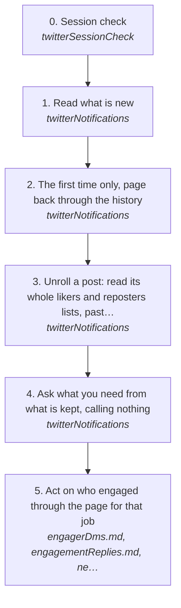

# Seeing who engaged with your posts

After a post goes out, people like it, repost it, reply, quote it and follow you. This page pulls all of that from the account's X notifications, new and back through the history, keeps it on this machine, and gives the agent a list of who did what on which post. It sends nothing.

How the owner asks for it: "check my x notifications", "who liked my tweet", "who engaged with my post since <date>", "pull my twitter notifications".

## Run it from a fresh context

Say: **"go on docs/useCases/twitter/notifications.md for <account>"**, or "who liked <post url>", or "who engaged since <date>". The agent then reads this page and [README.md](README.md) and runs the steps.

## The steps

<!-- stepsDiagram: written by `bun run docs:build` from the steps table below, not edited by hand -->

<!-- /stepsDiagram -->

| # | Step | Tool | Done when |
| --- | --- | --- | --- |
| 0 | Session check | `twitterSessionCheck` | `loggedIn` |
| 1 | Read what is new | `twitterNotifications` { account } | `notificationSync` says `caughtUp`, or a page cap |
| 2 | The first time only, page back through the history | `twitterNotifications` { account, full: true } | `historyDone`, or run it again later for the rest |
| 3 | Unroll a post: read its whole likers and reposters lists, past the few a notification names | `twitterNotifications` { account, post } for one post, or { account, full: true, since } for every post with an "and N others" notification | `unroll.state` is `done` and the post's `likes` and `reposts` say `readToTheEnd`; `stopped` means run it again later for the rest |
| 4 | Ask what you need from what is kept, calling nothing | `twitterNotifications` { account, stored: true, type, since, post } | the rows, `counts` by kind, `engagerPosts` for a post and `engagers` ranked by how much each person did |
| 5 | Act on who engaged through the page for that job | [engagerDms.md](engagerDms.md), [engagementReplies.md](engagementReplies.md), [networkMaxing.md](networkMaxing.md) | that page's own done |

Each row is one person doing one thing: `kind` (like, repost, reply, quote, follow, mention, other), `handle` and `userId`, `followsYou`, which of the account's posts (`postId`, `postUrl`, `postText`), when (`at`), and for a reply or quote their own tweet (`tweetUrl`, `text`). `type` is likes, reposts, replies, quotes, follows or all; `post` takes a post id or url. `source` says where the row came from: `notification`, or `engagements` for a person only the post's likers or reposters list names (their `at` is null, because the list gives no time, so `since` leaves them out).

For each post unrolled, and for `post` from what is kept, the answer says how many likers and reposters came from notifications (`fromNotifications`), how many unrolling added (`addedByUnroll`), the `total`, and whether the list was `readToTheEnd`, `stoppedBeforeTheEnd` or `notUnrolled`. In text that is one line a post: `post <id>: likers 154 from notifications + 87 added by unrolling = 241 (read to the end); reposters ...`.

## What to know

- **One read, many pages, one session.** The read goes through the account's one X session, its engine host, never a session of its own (rule 105), one call on the account at a time, so the queue's sends wait for it and it waits for them. Pages are 40 notifications, 4 to 11 s apart, each through the account's governor. A 429 or a governor stop ends the read and keeps what came; nothing reads again until the owner says so (rule 94). Another run sending on the same account shares the same governor.
- **X decides how far back.** `--full` goes on from where the last one stopped, 25 pages a run by default (`pages`), until X gives no more.
- **Aggregated notifications are opened up, then unrolled.** "@a and 12 others liked your post" is kept as one row per person X names, and X names only some of them. The unroll reads the post's whole likers list and reposters list and adds everyone the notification left out, under the same key, so a person in both is one row. The account's own actions are never kept.
- **One state machine runs the read.** The feed, then which posts, then likers page by page, then reposters page by page, five pages a call, at most 40 pages a run. A 429, a governor stop or the page cap ends it `stopped`, said plainly, with every row and each list's place kept; the next run goes on from there. It never retries by itself (rule 94).
- **The lists need X's live operation.** If the answer is `engagersOperationUnknown`, X was not called: read the account's X web client once (`log twitter session webClient`), then read again.
- **Kept, not synced anywhere.** The rows live in `~/.logCli/twitter/<account>/notifications.json`, never in Twenty.

## What X shows

X shows the likes on the account's own posts only, never on someone else's. Its notifications name a few of the people behind "and N others"; its post engagements screen shows the author every liker and reposter, and that screen's lists are what the unroll reads. A list gives people, not times, so a person only the list names has no `at`. The count X shows on a post can still sit above the total kept: X counts the account's own like, and people whose accounts are gone or hidden are not in the list.
