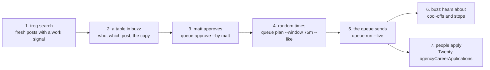
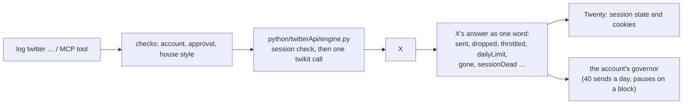

# Recruiting on X with a reply queue

How matt recruits people on X: find people who just posted that they want work, reply to each one with a short line in their own language that points at the job page, and send the replies slowly over an hour or two from his own account. This page shows each step, which part of log-cli does it, and a real run.

## The idea in one line

Search X for fresh posts with a work signal, write one personal reply per person, get matt's approval for the whole list, then let a queue send the replies at random moments, with likes mixed in.



## A real run (2026-10-24)

Two roles were open on listeningkit.com: the Business Development Operations Specialist (the "Jarvis" role) and a remote cold caller / appointment setter for Latin America.

- **The search** used treg's X search, never X itself (rule 53). A language-only search (`lang:es`, `lang:tl`, `lang:hi`) brought back noise, so each query added one work word: "busco trabajo", "naghahanap ng trabaho", "virtual assistant", "CRM", "cold calling", "call center". The BDO sweep ran 60 queries and found 572 authors, about 211 of them in the Philippines, India, Africa or Latin America. The search cost about $0.05 and the profile reads about $0.13. The cold-caller sweep ran 102 Spanish queries and found 622 people.
- **Qualified** meant: the post is in that language and from the last 3 days, the profile's location is in one of those regions, it's a real person with a work signal, and they were never contacted before (the send logs in `OUTBOX/RECRUITMENT_SEND_LOG_*.tsv`).
- **The copy** is one line per person, in their language, about their own post, in the house style: all lowercase, no commas, no full stops, no dashes (urls are fine). One BDO reply read:

  > nakita ko na naghahanap ka ng work naghi-hire kami ng remote business development operations specialist apply ka dito &lt;job link&gt;

  One cold-caller reply read:

  > vi tu post y por si te interesa buscamos cold callers remotos que llamen en inglés a negocios de ee uu para agendar citas 👉 &lt;job link&gt;

- **The result that day:** 14 replies went out from @matthewsoldit (8 BDO, 6 cold caller). Two didn't post at first: one person had replies switched off (skipped), and one reply came back "x created no tweet". That second one was the reason for the rule below: a plain loop lost it, and the queue sent it again later. 4 people had applied for the BDO role by then.

matt's rule from that day: any send to two or more people goes through the queue, with approval, random times and likes, never a hand-written loop.

## Who does what

| Step | Who | What they use |
| --- | --- | --- |
| Wake up daily, check applicants | the `recruiter` agent in buzz (#agency-recruitment-handoff) | Twenty `agencyCareerApplications` |
| Find people | the `recruiter` agent, or matt-claude | treg `anyapi.x.search.posts`, `anyapi.x.user.profile` |
| Judge who fits | matt-claude | the table the recruiter posts in buzz |
| Approve | matt | `log twitter queue approve --by matt` |
| Send | the queue on matt's account | `log twitter queue run --live` |

## The commands, step by step

Each step is a `log twitter` command and an MCP tool of the same name (`twitterQueueBuild`, `twitterQueueRunLive`, …). They all run on the direct-API engine: twikit, calling X directly with the account's saved session, no browser and no proxy (rule 80).

**0. Is the account still logged in?**

```bash
log twitter session check --account matthewsoldit
```

X's own answer decides. The result goes to Twenty (`socialAccounts.sessionState`), and X's refreshed cookies are saved back.

**1. Build the queue** from the people you found and the lines you wrote:

```bash
log twitter queue build --targets targets.json --variations lines.json --out queue.json --account matthewsoldit
```

`targets.json` is a list of `{handle, tweet_url, post_text}` (or `user_id` for DMs). `lines.json` is a list of lines. Each person gets a different line. Nothing is sent.

**2. Look at it, and check it:**

```bash
log twitter queue show queue.json
log twitter queue check queue.json
```

`check` runs every line through the house style and checks every post url, and contacts nothing.

**3. Approve it:**

```bash
log twitter queue approve queue.json --by matt
```

This saves a fingerprint of the account plus every item's target and copy. Change one word afterwards and the approval no longer counts, so the run refuses until it is approved again.

**4. Draw the times:**

```bash
log twitter queue plan queue.json --window 75m --like
```

Every reply (and, with `--like`, a like on some of the posts, before or after the reply) gets a random moment inside the window, at least two minutes apart.

**5. Run it:**

```bash
log twitter queue run queue.json
log twitter queue run queue.json --live --alertChannel <buzz channel> --alertMention <matt's pubkey>
```

Without `--live` it is a dry run that lists what it would send and when. With `--live` it sends, one at a time, at those times. It saves after every step, so starting it again picks up where it stopped. What it does when X pushes back:

- **X made no tweet, or slowed us down:** it waits 15 minutes, then 30, then 1, 2 and 4 hours (or until the time X gives), and tries that post once more at the end.
- **Daily limit (code 344):** it waits 24 hours.
- **Post deleted or replies off (385, 433):** it skips that person.
- **Session gone, or 5 waits in a row with nothing sent:** it stops and tags matt in buzz.

**6. Hurry it up:** `log twitter queue nudge queue.json --replies 2` tells a running queue to send the next two now.

**7. One-off sends**, when it's just one person: `log twitter reply`, `quote`, `like` and `dm`. They are dry runs until `--live --approvedBy matt`.

**8. Who follows back:** `log twitter follows --account matthewsoldit --handles a,b,c` reads, for each handle, whether they follow the account and whether it follows them. It sends nothing.

## What log-cli does underneath



- Code: `src/twitter/queue/plan` (the queue file, approval, the times), `src/twitter/queue/run` (the queue as an XState machine: planned, waiting, liking, replying, cooling, finished, halted), `src/twitter/post/send` (one send's checks), `src/twitter/copy/style` (the house style).
- The queue file is the same one twitter-controller wrote, so an old queue still loads and stays approved.
- Every account has its own governor under `~/.logCli/twitter/<account>`.

## Not built yet

- Tracking who replied back. Applicants arrive through the job page, in Twenty `agencyCareerApplications`.
- Reading DMs into Twenty.

## Ways to reuse it

The pieces don't care what the message is about. A queue is just "these people, these lines, approved by someone, sent slowly". A few shapes it already fits:

- Any list of people found by a treg search, where each one gets a short personal reply.
- DMs instead of replies: `--action dm` on `queue build`, with each person's `user_id`.
- Likes only, one at a time: `log twitter like`.
- Checking who followed back after a round: `log twitter follows`.

Sources: `GUIDES/X_OUTREACH_TREG_TO_TWITTER_CONTROLLER.md`, `GUIDES/X_SEQUENCER_HOW_TO.md`, `GUIDES/JARVIS_RECRUITER_STANDING_ORDERS.md`, `RESEARCH/JARVIS_QUALIFIED_SWEEP_2026-10-24.md`, `RESEARCH/COLD_CALLER_LATAM_SWEEP_2026-10-24.md`, `OUTBOX/RECRUITMENT_SEND_LOG_2026-10-24.tsv` (all in the buzz workspace), and `docs/twitterPlatform.md` here.
