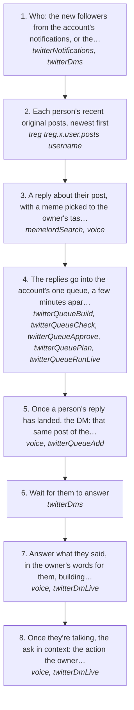

# Reply guy, then the DM, then the ask

The owner's way of getting new people to do something for him (share a post, try a tool): reply to them in public first, then open a DM on their own post, build on what they say, and only then the ask. In his words: "you're meant to reply guy them first and foremost. You go on, like a tweet, send a meme to the tweet, and then we're gonna forward the tweet to them as an opener, talking and building on top of it, and then you wait for the reply, and then you say something that's in context that then build on top of the conversation that then funnel them into doing an action."

It is [managerMaxxing.md](managerMaxxing.md)'s touches for anyone: new followers, people who engaged, or a list the owner names. People already talking to the owner skip the first touches and go to [getTheAction.md](getTheAction.md).

How the owner asks for it: "reply guy them first and foremost", "send a meme to the tweet then forward the tweet to them as an opener", "message the people who are new to following me", "get it in front of them", "funnel them into doing an action".

## Run it from a fresh context

Say: **"go on docs/useCases/twitter/replyGuyFunnel.md for <who> and <the action>"** (for example: the new followers, share https://x.com/matthewsoldit/status/2118876082409725989). The agent reads this page, [README.md](README.md) and [networkMaxing.md](networkMaxing.md), loads `getGuide({ topic: "xSending" })` and `getGuide({ topic: "extensions" })`, and runs the steps.

## The steps

<!-- stepsDiagram: written by `bun run docs:build` from the steps table below, not edited by hand -->

<!-- /stepsDiagram -->

| # | Step | Tool | Done when |
| --- | --- | --- | --- |
| 1 | Who: the new followers from the account's notifications, or the people the owner names. Drop anyone already talking to the owner (they go to getTheAction), anyone over 1500 followers (rule 121), the owner's own accounts and anyone the agent memory says never to message | `twitterNotifications` { account }, `twitterDms` { account, with } | a list of new people, each with their user id |
| 2 | Each person's recent original posts, newest first. Someone with no post from the last month has nothing to reply to: hold them and say so | [treg](https://treg.to/?ref=matthewdonse-aebsh) `treg.x.user.posts` { username } | one post per person worth replying to, or held |
| 3 | A reply about their post, with a meme picked to the owner's taste for that moment and uploaded as media. Each reply is about that post alone, so no two read alike (rule 157). Gate every one | `memelordSearch`, `voice` { to, context, text } | every reply passes, and none repeats another |
| 4 | The replies go into the account's one queue, a few minutes apart, each liking the post and following them first (rules 104, 107, 121) | `twitterQueueBuild` { action: "reply" }, `twitterQueueCheck`, `twitterQueueApprove`, `twitterQueuePlan`, `twitterQueueRunLive` | X answers `sent` for each reply |
| 5 | Once a person's reply has landed, the DM: that same post of theirs forwarded first, then one line that builds on it and on the reply. The opener only, never the ask (rule 98), written from their post so no two read alike | `voice` { to, context, text }, `twitterQueueAdd` { action: "dm" } | each opener passes and goes into the same queue |
| 6 | Wait for them to answer. The inbox hook brings each answer in the moment it lands; read their whole thread then | `twitterDms` { account, with } | they answered, or they haven't yet |
| 7 | Answer what they said, in the owner's words for them, building on it: about them and what they're doing, still no ask | `voice` { to, with, context, text }, `twitterDmLive` | the conversation is going |
| 8 | Once they're talking, the ask in context: the action the owner wants (share the post, try the tool), in a way that fits what they said, with the link | `voice` { to, with, context, text }, `twitterDmLive` | they did it, or the owner knows where it stands |

## What to know

- **Never skip the reply.** A cold DM with the ask in it to someone who just followed is what X reads as automation, and what the owner never wants. The reply comes first, the opener second, the ask last.
- **No two messages alike.** A reply, opener or ask that repeats another one the account sent in the last 24 hours is refused with `sameAsSent` (rule 157). A template with a different first line is still a template.
- **One play at a time.** Loading this page makes it the session's play, and every log tool's answer says which step it is and what comes next (rule 157).
- Every send counts against the account's writes for the day, and X's own daily limit (344) can come at around 40; spread the people over days. Any refusal stops the run (rule 94).
