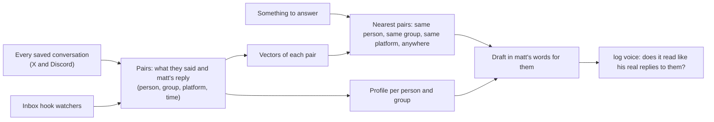

# Writing as matt, per person and per group

How log would write the way matt writes **to this person, in this chat**, instead of from one fixed guide. Outlined 2026-10-28 from what log already has; the deep research on how others do it (`~/.buzz/RESEARCH/VOICE_VECTORISE/`) is read against this.

## What's wrong today

`log voice` gates a draft against `GUIDES/MATT_WRITING_STYLE.md` (256 of his tweets) and a few of his DMs. That's one voice for everyone. matt doesn't write to Jilly the way he writes in the log group, or to a cold lead the way he writes to deepman. The guide can't know that.

## What log already holds

`log search index` keeps every conversation in `~/.logCli/conversations/<platform>/<account>/`, each message marked `fromMe`. On 2026-10-28 that is **8,328 messages matt wrote himself**: 7,464 on Discord, 864 on X, across 337 conversations, each with who it was to, when, and what came just before it.

## How it would work

1. **Pairs, not loose messages.** Each of matt's messages is kept with what he was answering (the message or messages just before it from someone else) and where it was (platform, person or group). That pair is the unit: "they said this, matt said that".
2. **One vector per pair.** The same local embedder `log search` already uses (all-MiniLM-L6-v2, verso-db HNSW) embeds what they said. A second index holds matt's reply text, for "find me how matt says X".
3. **A profile per person and per group**, counted, not guessed: how long his messages to them run, lowercase or not, which words and openers he uses with them (lad, bro, g, cuh), emoji, questions, how fast he replies. Kept beside the pairs and rebuilt when they change.
4. **When there's something to answer**, log looks up the closest pairs, nearest first in this order: the same person, the same group, the same platform, anywhere. Say the 8 best, plus that person's profile.
5. **The draft is written from those**: what they said, matt's real replies to things like it (most of them to this same person), and how he writes to them. Only facts matt has said, as now.
6. **The gate checks against the same evidence.** `log voice` reads the draft beside those pairs and the profile (SubQ), and asks: does this read like matt's real replies to this person? It stops scoring against the one global guide alone.
7. **It stays current by itself.** The inbox hook's watchers (X Chat and the Discord gateway) already see every message as it lands; each new one from matt goes into the pairs at once, so the next draft knows what he said an hour ago.

## One real example

Jilly (a bot, in a DM) and the log group (QuadScorpion, Kennedy, John, deepman) both get messages from matt. Asked to tell the log group the MCP works, log finds matt's past messages *in that group* and his profile for it, and drafts in that register: "the log mcp works on discord now so it reads all 176 chats…". To Jilly it would look up how he writes to Jilly instead, so it doesn't sound the same.

## Diagram

## Built on what log already has (matt, 2026-10-28: don't veer off what's done)

The research (`~/.buzz/RESEARCH/VOICE_VECTORISE/VOICE_VECTORISE_REPORT.md`) found no repo that does all of this, and recommends pairs, per-person filters and retrieval first. Every part of that maps onto log's own pieces:

| The research's idea | What log already has | What's new |
| --- | --- | --- |
| Pairs of what they said and matt's reply | `~/.logCli/conversations` (every X and Discord chat, each message `fromMe` or not, who, when) | `log voice index` builds the pairs from it; nothing new is read |
| A vector per pair, nearest first | `log search`'s embedder (all-MiniLM-L6-v2), verso-db HNSW, bm25s, RRF, 8 ms p99 | A second index in `~/.logCli/search/voice`, same code |
| Filter by person and group | `log search --with --platform --account` | The same filters, ranked same person, same group, same platform, anywhere |
| How he writes to each person | nothing yet | The counted profile per person and group |
| Draft, then check | `log voice`'s SubQ gate | `log voice --with <person or chat>` hands the nearest pairs and the profile to the draft and gates against them |
| Stays current | the inbox hook's watchers push every message | Each new message of matt's goes into the pairs |

Left out unless the drafts still read the same to everyone: fine-tuning (CloneUs, PanzaMail) and a separate style model (LUAR).

The test: draft one reply to Kennedy and to Jilly; the two must differ, and each must read like matt's real messages to them.

## Built (2026-10-28)

- `log voice index`: 3,213 of matt's replies paired with what was said before them, 551 profiles (chat, person, platform), in about a minute, from the saved conversations, nothing read again. `src/voice/pairs`.
- `log voice --to <who> --with <chat> --context "<what they said>"`: matt's nearest real replies there (same chat, same person, same platform, anywhere) and how he writes there, to draft from. With `--text` the gate adds `toThem`: does it read like his real replies there.
- Kennedy against Jilly, the same question: the log group gets short bursts (median 14 words, 2 in a row, 6.2 s apart), Jilly one longer message (median 28 words, one every time).
- `log discord send` splits a draft the way matt sends in that chat: how many he sends in a row and how many words each runs to, from his own messages there; it cuts at the draft's own line breaks or punctuation, else before a word matt really starts his messages with (learned from all 3,213 replies, never a word list), and sends them his usual gap apart. A chat where he mostly sends one gets one; `--asOne` always sends one.

## Where it lives

- `src/voice/pairs`: builds the pairs from the saved conversations.
- `src/voice/profile`: the counted profile per person and group.
- `log voice` gets `--with <person or chat>` and reads both.
- `log voice index` builds or refreshes it.
