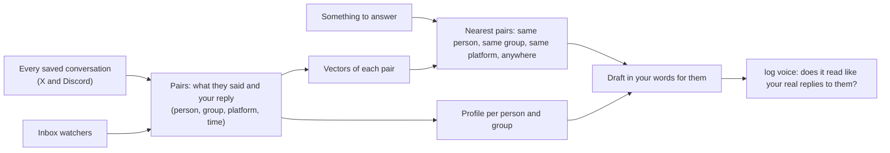

# Writing in your voice, per person and per chat

log can draft messages that sound like you, but people write differently to different people: short bursts in a busy group, longer messages to one friend, more formal to someone new. This page explains how log learns how you write to each person and each chat from your own saved conversations, and uses that to draft and check replies. Read it if you use `log voice` or `log voice index`, or want to know why two drafts on the same topic come out differently.

## The problem with one style guide

`log voice` used to check a draft only against one writing-style guide built from a few hundred of your public posts and some of your DMs. That's one voice for everyone. But you don't write to a close friend the way you write in a group chat, or to a cold lead the way you write to a regular. One guide can't know that.

## What log already has

`log search index` keeps every conversation in `~/.logCli/conversations/<platform>/<account>/`, with each message marked `fromMe` or not. That's typically thousands of your own messages across hundreds of conversations, each with who it was to, when, and what came just before it.

## How it works

1. **Pairs, not loose messages.** Each of your messages is kept with what you were answering (the message or messages just before it from someone else) and where it was (platform, person or group). The pair is the unit: "they said this, you said that".
2. **One vector per pair.** The same local embedder `log search` uses (all-MiniLM-L6-v2, verso-db HNSW) embeds what they said. A second index holds your reply text, for "how do I usually say X".
3. **A profile per person and per group,** counted, not guessed: how long your messages to them run, whether you use lowercase, which words and openers you use with them, emoji, questions, and how fast you reply. It's kept beside the pairs and rebuilt when they change.
4. **When there's something to answer,** log looks up the closest pairs, nearest first in this order: the same person, the same group, the same platform, anywhere. It takes about the 8 best, plus that person's profile.
5. **The draft is written from those:** what they said, your real replies to similar messages (mostly to this same person), and how you write to them. It only uses facts you've actually said.
6. **The check uses the same evidence.** `log voice` reads the draft beside those pairs and the profile (through SubQ) and asks whether it reads like your real replies to this person, instead of scoring against the one global guide alone.
7. **It stays current by itself.** The inbox watchers (X Chat and the Discord gateway) already see every message as it lands, and each new one from you goes into the pairs at once. The next draft knows what you said an hour ago.

## An example

Say you message both a group chat and one person in a DM. Asked to tell the group that a feature works now, log finds your past messages *in that group* and your profile for it, and drafts in that register: short, casual, a couple of quick lines. For the one person, it looks up how you write to them instead, so the message doesn't sound the same.

## Built on what log already had

Research into how others do this found no project that does all of it, and recommended pairs, per-person filters and retrieval first. Each part maps onto something log already had:

| Idea | What log already had | What's new |
| --- | --- | --- |
| Pairs of what they said and your reply | `~/.logCli/conversations` (every X and Discord chat, each message `fromMe` or not, who, when) | `log voice index` builds the pairs from it; nothing new is read |
| A vector per pair, nearest first | `log search`'s embedder (all-MiniLM-L6-v2), verso-db HNSW, bm25s, reciprocal rank fusion, 8 ms p99 | A second index in `~/.logCli/search/voice`, same code |
| Filter by person and group | `log search --with --platform --account` | The same filters, ranked: same person, same group, same platform, anywhere |
| How you write to each person | nothing | The counted profile per person and group |
| Draft, then check | `log voice`'s SubQ gate | `log voice --with <person or chat>` passes the nearest pairs and the profile to the draft and checks against them |
| Stays current | The inbox watchers push every message | Each new message of yours goes into the pairs |

Fine-tuning a model (as CloneUs and PanzaMail do) and a separate style model (LUAR) are left out unless drafts still read the same for everyone.

The test: draft one reply to two different people on the same question. The two must differ, and each must read like your real messages to them.

## What's built

- **`log voice index`** pairs your replies with what was said before them and builds a profile for each chat, person and platform, from the saved conversations, without reading anything again. A few thousand replies and a few hundred profiles take about a minute. Code: `src/voice/pairs`.
- **`log voice --to <who> --with <chat> --context "<what they said>"`** shows your nearest real replies there (same chat, same person, same platform, anywhere) and how you write there, to draft from. With `--text`, the check adds `toThem`: does it read like your real replies there?
- **Two chats really differ.** In one test, a group chat got short bursts (median 14 words, 2 in a row, about 6 seconds apart) and a one-to-one chat got one longer message (median 28 words, one at a time).
- **Sending splits a draft into several messages.** A draft written on several lines goes out as one message per line, in every chat. A one-line draft is split the way you usually send in that chat: how many messages in a row and how long each runs, learned from your own messages there. It cuts at the draft's line breaks or punctuation, or else before a word you really start messages with (learned from your replies, never a fixed word list), and sends them your usual gap apart. `--asOne` sends it as one message.

## Where it lives

- `src/voice/pairs`: builds the pairs from the saved conversations.
- `src/voice/profile`: the counted profile per person and group.
- `log voice --with <person or chat>` reads both.
- `log voice index` builds or refreshes them.
