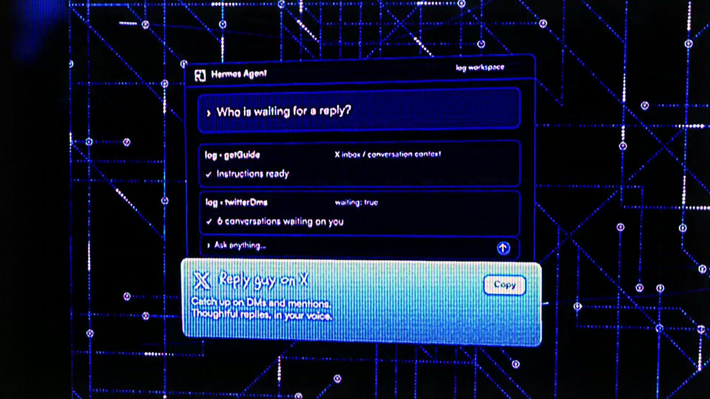
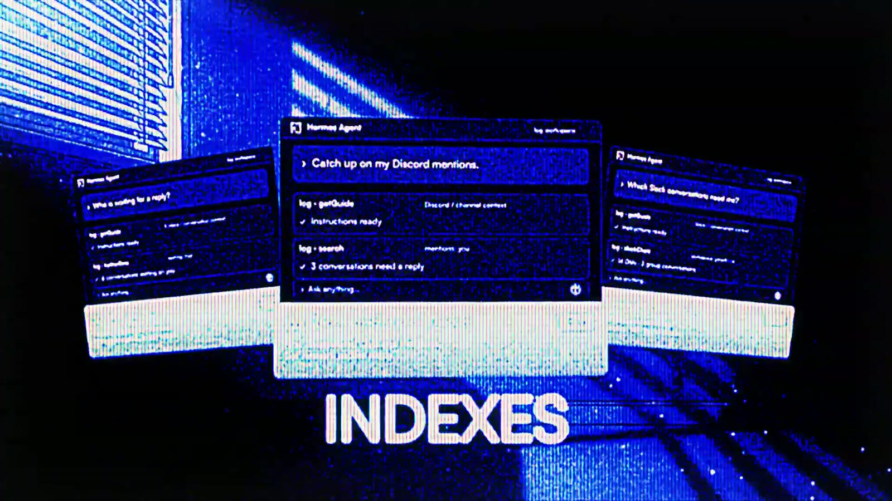
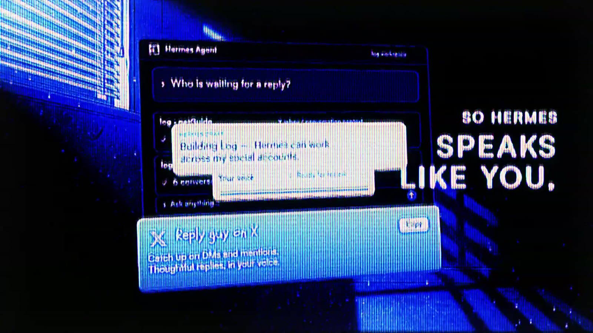
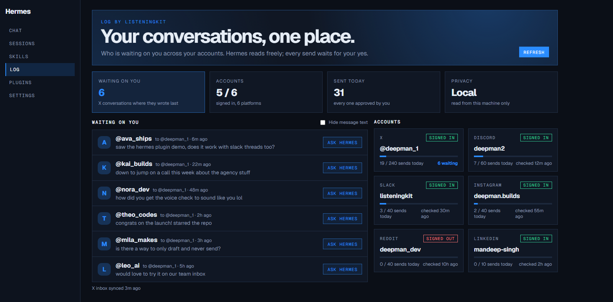

# log for Hermes


Your agent, working your DMs the way you would.

Every conversation you've ever had holds an opportunity: someone waiting on a reply, a follow-up you forgot, a lead that went quiet. This plugin gives Hermes [log by ListeningKit](https://github.com/matthewdonsemail-lab/log), an open-source tool that reads and sends from your own X, Discord, Slack, Instagram and Reddit accounts, in your own voice. LinkedIn sign-in status is available; LinkedIn conversation reads and sends are not built yet.

Ask Hermes things like:

- "Who messaged me on X and Discord today, and who's waiting on a reply?"
- "Read my thread with @someone and draft an answer the way I'd write it."
- "Follow up with everyone who opened my DM but didn't reply."

Hermes reads freely. Every send, reply or post asks you first.



| Every platform you're on | Indexes every conversation |
|---|---|
|  |  |



## The log tab

Enable the plugin and Hermes's dashboard gets a **log** tab: who is waiting on a reply, every account you signed in with its session and today's sends against its daily limit. **Ask Hermes** copies a ready prompt for that conversation into your clipboard, so you paste it into chat and Hermes drafts the reply there. The tab only reads; it never sends.



Watch the launch video: [log on X](https://x.com/matthewsoldit/status/2120938715820474690).

## What's inside

An Agent Plugins v1 package:

- `mcp.json`: starts log's MCP server (`logMcp`) on your machine over stdio. Hermes gets log's tools as `mcp__log__*`: DM inboxes, conversation reads, session checks, search across past conversations, the voice check, and the send/reply/quote tools.
- `plugin.json`: marks the `log` server **untrusted**, so every tool not annotated read-only (anything that sends or changes an account) asks for approval and is refused in cron and other unattended runs. The tool-call timeout is 600 s, because a platform read can take a while.
- `skills/dm-inbox`: how to find who needs a reply and answer them: read the whole thread, pull how you actually write to that person, draft, check the draft, send only on your go.
- `skills/outreach`: replies, quotes and follow-ups in your voice.
- `dashboard/`: the log tab for Hermes's dashboard (`manifest.json`, `plugin_api.py`, `dist/`). Plain JavaScript on the dashboard SDK, no build step and no bundled libraries.

## Install

1. Install log and sign in your accounts (it keeps them on your machine). With [Bun](https://bun.sh):

   ```bash
   bun add -g @listeningkit/log
   log launch --setup
   ```

   log's [install guide](https://github.com/matthewdonsemail-lab/log/blob/main/docs/install.md) also has a one-line installer that sets up Bun and the Python its platform engines use. Check `logMcp` is on your PATH.

2. Install and enable the plugin:

   ```bash
   hermes plugins install listeningkit-log --no-enable
   hermes plugins enable listeningkit-log
   ```

## Disclosure

- **Dashboard tab:** its backend (`dashboard/plugin_api.py`) runs inside Hermes's dashboard only while the plugin is enabled. It reads, read-only, log's own files under `~/.logCli`: each account's `session.json`, its `governor_state.json` (today's request and send counts) and the X inbox log already synced (`inboxSync.json`), including message previews. It makes no network call, runs no command and writes nothing. The tab is served on Hermes's own local dashboard, behind its sign-in.
- **Local process:** the plugin runs `logMcp` from your log install as a long-running stdio process while Hermes is open. It is not bundled here; you install log yourself.
- **Network calls:** log calls the platforms you signed in (X, Discord, Slack, Instagram and Reddit, plus LinkedIn for its session check) directly, as your own accounts, and only when a tool runs. This plugin adds no telemetry and sends nothing anywhere else.
- **Data and credentials:** your account sessions, cookies and message history stay in log's own folder on your machine (`~/.logCli`). The plugin never reads cookies or credentials; only log does. The dashboard tab reads only the files named above. Nothing is put in `mcp.json`.
- **Writes:** sends, replies, quotes, likes and follows go out as you, so they are gated by Hermes approval (`trust: untrusted`) and by log's own per-account daily limits. log stops on any rate limit, block or failed send instead of retrying.
- **The tool set** comes from your installed log version at runtime and is not covered by this plugin's pinned commit.

## License

MIT
